# Generating grain microstructures in ExaConstit

ExaConstit's crystal plasticity models need to know which grain every element belongs to and how
that grain's crystal is oriented. The **microstructure generator** builds that information
directly on your finite element mesh. It places grains in any hexahedral or tetrahedral mesh
(curved, second-order meshes included), gives every grain a crystal orientation and a material,
and can move the mesh nodes so that element faces follow the grain boundaries instead of forming
stair steps. It works the same way for an idealized cube of grains, a machined specimen, a lattice
structure or measured 3D data.

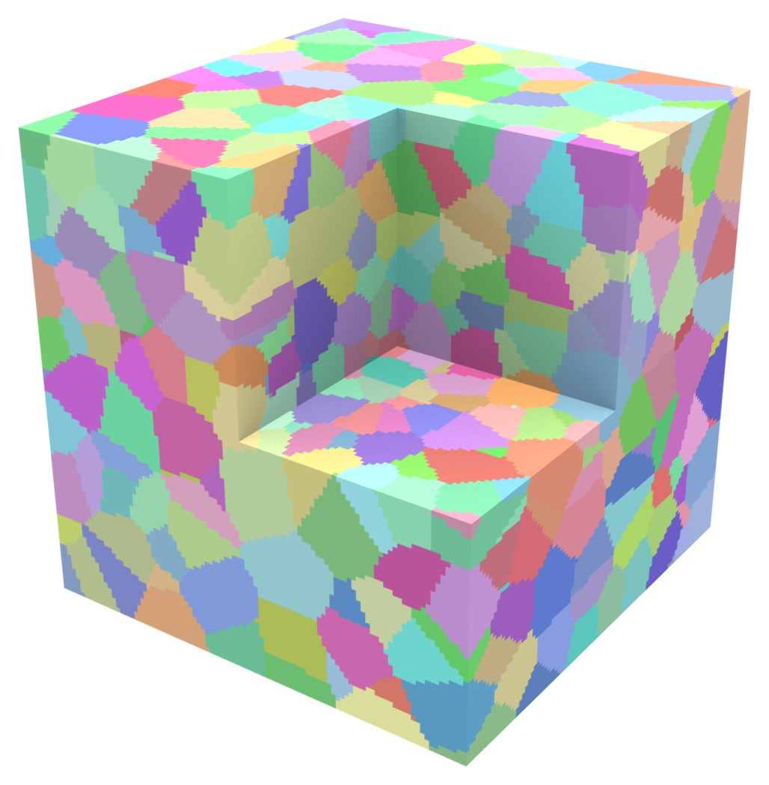

*1000 equiaxed grains in a unit cube meshed with $100^3$ hexahedra (about 1000 elements per
grain). Each grain has its own color; a corner is cut away to show the grains inside.*

This guide is written for materials scientists, material modellers, experimentalists and
computational mechanics engineers. It shows what the generator can make, which options produce
each kind of microstructure, and the ideas behind them. Every option is documented in full, with
its default and accepted values, in
[`src/microstructure_options.toml`](../src/microstructure_options.toml); this guide names only the
keys each feature needs. How the code is organized is described in the
[microstructure developer guide](microstructure_developers.md).

## Contents

1. [Two ways to run it](#1-two-ways-to-run-it)
2. [A first microstructure](#2-a-first-microstructure)
3. [Your own mesh, units and grain size](#3-your-own-mesh-units-and-grain-size)
4. [Words used in this guide](#4-words-used-in-this-guide)
5. [How grains are made](#5-how-grains-are-made)
6. [A gallery of microstructures](#6-a-gallery-of-microstructures)
7. [Conformal grain boundaries](#7-conformal-grain-boundaries)
8. [Parts with holes, thin walls and lattices](#8-parts-with-holes-thin-walls-and-lattices)
9. [Measured or simulated data](#9-measured-or-simulated-data)
10. [Orientations, phases and materials](#10-orientations-phases-and-materials)
11. [Running inside an ExaConstit simulation](#11-running-inside-an-exaconstit-simulation)
12. [Choosing options: recipes, guidance and limitations](#12-choosing-options-recipes-guidance-and-limitations)
13. [Reference: file formats](#13-reference-file-formats)
14. [References](#14-references)

---

## 1. Two ways to run it

The generator comes in two forms that read the same options and, on the same mesh, make the same
grains.

- **The standalone tool** `microstructure_generator`, built next to `mechanics` in the `bin/`
  directory of the build. It reads a mesh (or makes a box), writes the mesh with its grains, the
  orientation file and a ParaView view, and needs no simulation set-up. **Start here** to look at
  grains and tune options; it is also the way to save a microstructure that several simulations
  share.
- **Inside a simulation.** A `[Mesh.Microstructure]` table in an ExaConstit options file makes
  ExaConstit build the grains in memory on its own mesh when the simulation starts, so no grain
  file, orientation file or region map is needed. This is the convenient route for production
  runs and for scatter studies, where every run needs a new random set of grains (section 11).

The tool runs in parallel with MPI, like `mechanics`:

```bash
mpirun -np 6 microstructure_generator -i my_grains.toml
```

The generator is part of the build when ExaConstit is configured with `ENABLE_MICROSTRUCTURE=ON`
(the default). It needs the Axom library; if Axom is not found, CMake turns the generator off
with a message, and neither the tool nor `[Mesh.Microstructure]` is available. The result does
not depend on the number of MPI processes. On GPUs (section 11) the labels can differ from a CPU
run in rare elements whose grain is decided by round-off.

## 2. A first microstructure

The options file below makes 1000 equiaxed grains in a unit cube meshed with $100^3$ hexahedra,
the run behind the picture at the top of this page
([`box_1000_grains.toml`](microstructure_figures/sources/box_1000_grains.toml)). Every key left
out keeps its default; `num_seeds` (the number of grains) is the one key without a default.

```toml
[Mesh]
    type = "auto"                # a box of hexahedra, like ExaConstit's own auto mesh
    [Mesh.Auto]
        length = [1.0, 1.0, 1.0]
        ncuts = [100, 100, 100]  # elements along x, y, z

[Seeds]
    num_seeds = 1000             # one seed per grain
    rng_seed = 1                 # another value gives another, statistically similar, set
    min_distance_factor = 0.5    # keeps seeds apart, for realistic equiaxed grains

[Tessellation]
    metric = "voronoi"

[Output]
    basename = "box_1000"
    paraview = true
```

Orientations are random unless you supply your own (section 10). The tool writes:

| File | Contents |
|---|---|
| `box_1000.mesh.gz` | the mesh, with the grain number of every element |
| `box_1000.grains` | the grain number of every element of the auto box, one per line |
| `box_1000.ori` | one orientation per grain |
| `box_1000_grains.csv` | one row per grain: orientation, element count, volume, center, neighbors |
| `box_1000_paraview/box_1000_paraview.pvd` | a ParaView view; open it and color by `grain_id` |

The end of the log says how to use these files in an ExaConstit simulation, for example:

```text
To use them in your own ExaConstit options file (...):
  [Mesh] type = "file", floc = "./box_1000.mesh.gz"
  or [Mesh] type = "auto" with [Mesh.Auto] length = [1, 1, 1], ncuts = [100, 100, 100] and top-level grain_file = "./box_1000.grains"
  one [[Materials]] block (single region; no region mapping file needed) with
    [Materials.Grain] ori_type = "quat", ori_stride = 4, num_grains = 1000, orientation_file = "./box_1000.ori"
```

Either the mesh file or the auto box with the grain file works; after a conformal fit
(section 7) only the mesh file carries the moved nodes.

**Other box shapes.** Keep the elements close to cubes: for a $2 \times 1 \times 1$ bar use
`length = [2.0, 1.0, 1.0]` with, for example, `ncuts = [80, 40, 40]` ($128\,000$ elements, about
250 per grain for 500 grains). A first look at a microstructure does not need $10^6$ elements;
the guidance in section 12 helps choose the resolution for the simulation itself.

## 3. Your own mesh, units and grain size

**Mesh files.** The generator and ExaConstit read the mesh formats MFEM reads: MFEM (`.mesh`,
`.mesh.gz`), Gmsh (`.msh`, versions 2.2 and 4.1), VTK (legacy `.vtk` and XML `.vtu`), Netgen,
TrueGrid, and Cubit/Exodus (with MFEM built with NetCDF). There is no Abaqus (`.inp`) or ANSYS
reader: export the mesh to Gmsh or VTK first, with Gmsh or Python's `meshio` package. Hexahedra,
tetrahedra, wedges and curved (second-order) elements all work.

```toml
[Mesh]
    type = "file"
    floc = "my_specimen.msh"
```

**Element sets.** Element sets become numbered *element attributes*: a Gmsh physical volume
group's number, or a VTK cell array named `material` or `attribute`. Note which number is which
set (for example gauge = 1, grips = 2): `active_attributes` limits the grains to some sets, and
`passthrough_attributes` keeps other sets as single blocks with their own material
(section 10). After generation the attributes hold grain numbers instead.

**Units.** The generator has no units: every length (box size, grain size, distances) is in the
units of the mesh coordinates. ExaConstit does not fix a length unit either; only the lengths you
give it (the mesh, velocity boundary conditions) must use the mesh unit. A unit cube is 1 mm on a
side if you decide that the mesh is in millimeters.

**From grain size to grain count.** A grain of equivalent diameter $d$ (the diameter of the
sphere with the same volume) has volume $\pi d^3 / 6$, so a part of volume $V$ holds about

$$
N \approx \frac{6\,V}{\pi\, d^3}
$$

grains. For example, a $2 \times 1 \times 1$ mm bar with 50 µm grains holds about
$6 \cdot 2 / (\pi \cdot 0.05^3) \approx 30\,000$ grains. Elongated grains of the same volume count
the same; use the equivalent diameter of the measured grain volume. Instead of `num_seeds`,
`[Seeds.Size] mean_diameter` gives the mean equivalent diameter directly and the generator works
out the count (section 6.3).

## 4. Words used in this guide

| Term | Meaning |
|---|---|
| Grain | one crystal; every element belongs to exactly one grain |
| Seed | the point a grain grows from; one seed makes one grain |
| Metric | the rule that measures which seed is "closest" to a point; it sets the grain shapes (section 5) |
| Orientation | the rotation of a grain's crystal lattice relative to the specimen, stored as a quaternion (four numbers describing a rotation, section 10) |
| Phase | what your data calls a material: matrix and precipitate, or two alloy phases. Numbered from 1 |
| Region | an ExaConstit material: region $r$ uses the $r$-th `[[Materials]]` block. Phases become regions (section 10) |
| Element attribute | the number an element carries in the mesh file (an element set); after generation, its grain number |
| Staircase | grain boundaries made of element faces, before a conformal fit |
| Conformal fit | moving the mesh nodes so element faces follow the grain boundaries (section 7) |
| Voxel map | a 3D image of a microstructure: a regular grid of boxes (voxels), each holding a grain number |
| Seed table | a list of grains, one row each: position and optionally orientation, phase, size, shape |
| Microstructure file | ExaConstit's HDF5 file for grain data: a grain table and, optionally, a voxel map (section 9) |
| RVE | representative volume element: a cube of material meant to behave like the bulk |
| RD, TD, ND | rolling, transverse and normal directions of a rolled plate |
| EBSD, HEDM | electron backscatter diffraction (surface orientation maps; serial sections give 3D) and high-energy X-ray diffraction microscopy (grains inside a specimen; far-field gives a grain list, near-field a 3D map) |
| DREAM.3D, ExaCA, SPPARKS | software that reconstructs or simulates 3D microstructures: EBSD reconstruction and synthetic generation, solidification of additively manufactured material, grain growth |
| HEXRD, MIDAS | software that turns far-field HEDM measurements into grain lists |
| MPI process (rank) | one of the parallel processes a run uses |

## 5. How grains are made

Every run follows the same sequence. Each table of the options file controls one step.

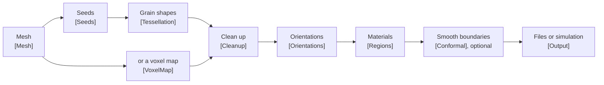

### Seeds

A grain grows from a **seed**. Seeds can be completely random (a *Poisson process*: every
position equally likely, independent of the others), kept a minimum distance apart, placed on a
regular pattern, created over time by a nucleation model (section 6.4), or read from a table of
measured grains (section 9). The random number key `rng_seed` makes every random choice
reproducible.

### Distance rules (the metric)

Each point of the part belongs to the seed that is "closest" to it, and the rule that measures
"closest", the **metric**, decides the grain shapes. With $\mathbf{x}$ a point and
$\mathbf{s}_i$ the position of seed $i$:

| `metric` | Point $\mathbf{x}$ belongs to the seed with the smallest | Grains |
|---|---|---|
| `"voronoi"` | $\lVert \mathbf{x}-\mathbf{s}_i \rVert$ | flat faces halfway between neighboring seeds |
| `"laguerre"` | $\lVert \mathbf{x}-\mathbf{s}_i \rVert^2 - w_i$ | flat faces; a larger weight $w_i$ gives a larger grain |
| `"additive"` | $\lVert \mathbf{x}-\mathbf{s}_i \rVert - a_i$ | curved faces; a seed with a head start $a_i$ grows further |
| `"quadric"` | $(\mathbf{x}-\mathbf{s}_i)^{\mathsf T} \mathbf{A}_i\, (\mathbf{x}-\mathbf{s}_i) - w_i$ | elongated, flattened or columnar grains |

The **Voronoi** rule is the classical model of a polycrystal whose grains all started growing at
the same time and speed. **Laguerre** (also called a *power diagram*) adds one weight per grain
and is the natural way to control grain sizes while keeping flat faces. The **additive** rule
describes grains that started growing at different times (Johnson-Mehl). The **quadric** rule
uses a stretched distance: where the tensor $\mathbf{A}$ is small along a direction, distances
along it count less and grains grow longer that way.

### From grains to elements

A grain boundary rarely follows element faces, so an element cut by a boundary must choose one
grain. With `sampling = "centroid"` (the default) it takes the grain at its center. With
`sampling = "quadrature_vote"` it is divided into $8^{n}$ small pieces ($n$ = `vote_levels`,
default 2) and takes the grain that holds most of its volume, which gives more accurate grain
volumes and fewer odd elements sticking out of grains. The vote is worth it when grains have fewer
than about 100 elements, on tetrahedral meshes and on curved elements.

### Clean-up, orientations and materials

After labeling, the **clean-up** step makes every grain one connected piece of elements (a grain
cut in two by a hole becomes two grains or joins a neighbor) and can merge grains too small for the
mesh to represent. Every grain then gets a crystal **orientation** (random, or from your data) and
a **region**, the ExaConstit material it uses. Finally the optional **conformal** step moves the
mesh nodes so that element faces follow the true grain boundaries (section 7).

---

## 6. A gallery of microstructures

Every picture in this section shows about 1000 grains on a mesh of at least $100^3$ hexahedra,
with a corner cut away and one random color per grain. The full options file of each picture is
linked under it; the snippets show only the keys that make the difference.

### 6.1 Random Voronoi grains

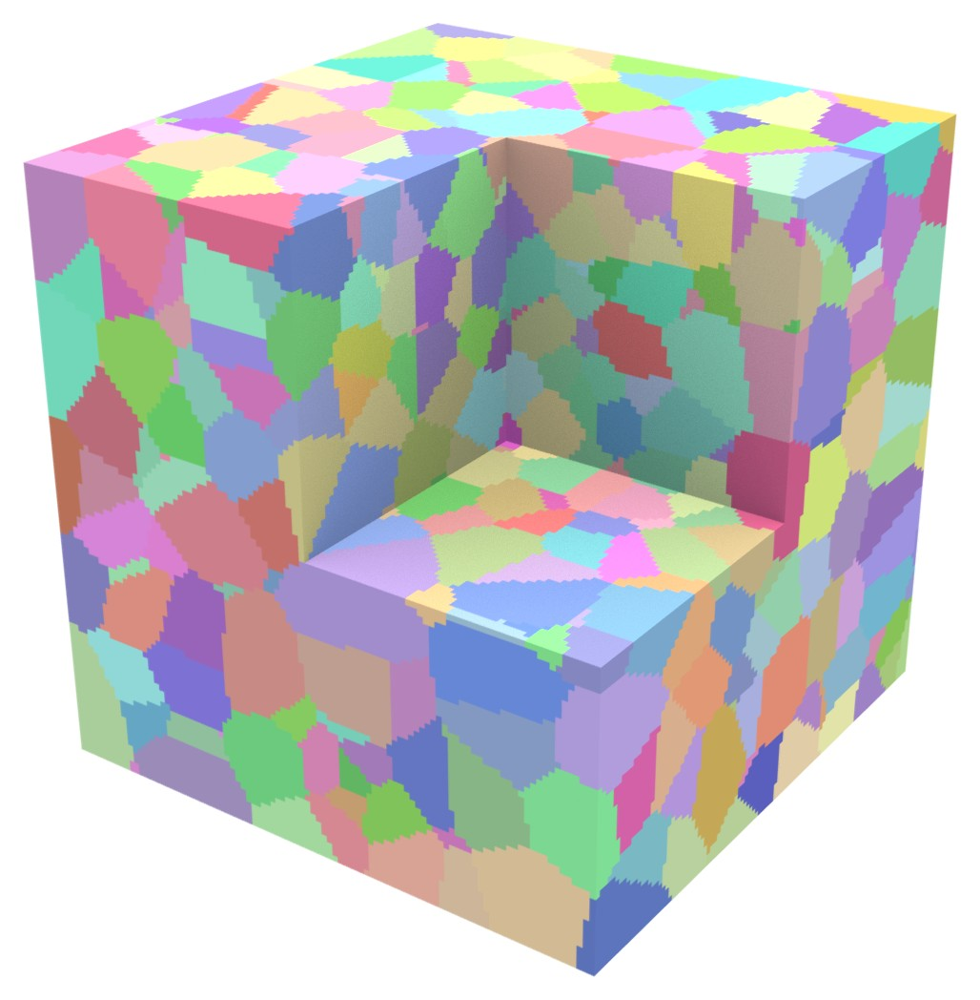

*1000 Voronoi grains from completely random seeds, $100^3$ hexahedra.*

Completely random seeds give the **Poisson-Voronoi** structure, the textbook random polycrystal.
Its grain sizes vary widely: seeds that land close together make small, sliver-like grains next to
large ones, a wider spread than in most annealed metals.

```toml
[Seeds]
    num_seeds = 1000
[Tessellation]
    metric = "voronoi"
```

Options file: [`voronoi_random.toml`](microstructure_figures/sources/voronoi_random.toml).

### 6.2 Equiaxed grains

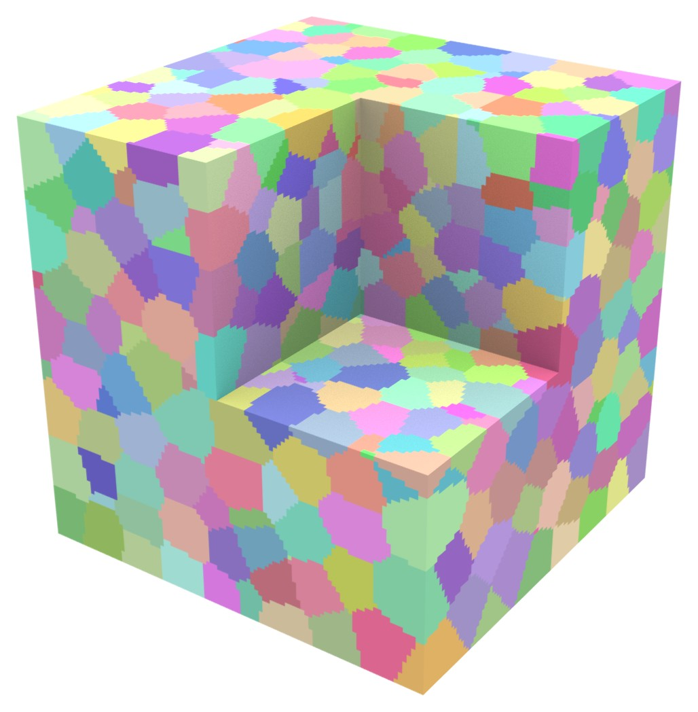

*1000 equiaxed grains: seeds kept apart, then three Lloyd steps. $100^3$ hexahedra.*

Keeping seeds a minimum distance apart removes the slivers and gives the even, equiaxed grains of
an annealed metal. `min_distance_factor` is that distance as a fraction of the average seed
spacing $(V/N)^{1/3}$; 0.3 to 0.6 is typical. **Lloyd relaxation** goes further: each step moves
every seed to the center of its grain, so the grains become rounder and more alike. One to three
steps give a mild effect; ten or more give an almost regular, honeycomb-like structure.

```toml
[Seeds]
    num_seeds = 1000
    min_distance_factor = 0.5
[Tessellation]
    metric = "voronoi"
    lloyd_iterations = 3
```

Options file: [`equiaxed.toml`](microstructure_figures/sources/equiaxed.toml).

### 6.3 A prescribed grain size distribution

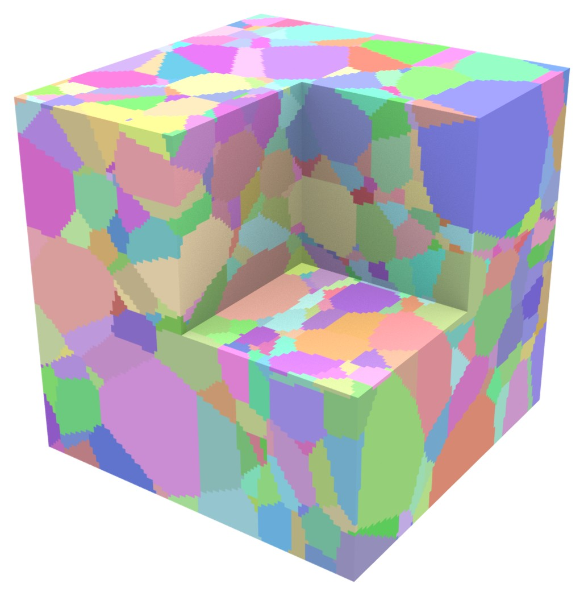

*1000 Laguerre grains with a log-normal size distribution ($\sigma = 0.5$), $100^3$ hexahedra.*

Measured grain sizes are usually well described by a **log-normal** distribution: the logarithm of
the equivalent diameter $d$ is normally distributed with standard deviation $\sigma$. About two
thirds of the grains have a diameter within a factor $e^{\sigma}$ of the median. Values of $\sigma$
between 0.3 and 0.5 are common for annealed metals. If your measurement reports the coefficient of
variation $\mathrm{CV}$ of the diameter, use $\sigma = \sqrt{\ln(1 + \mathrm{CV}^2)}$.

The generator draws a target volume for every grain, places the seeds so that big grains get more
room (`polydisperse_placement`), and adjusts the Laguerre weights $w_i$ until every grain has its
target volume within `tolerance` (`fit_volumes`). The faces stay flat.

```toml
[Seeds]
    num_seeds = 1000
    [Seeds.Size]
        distribution = "lognormal"
        sigma = 0.5
        polydisperse_placement = true
[Tessellation]
    metric = "laguerre"
    fit_volumes = { enabled = true, tolerance = 0.03, max_iterations = 200, samples = "quadrature" }
```

Instead of `num_seeds`, `mean_diameter` (the mean equivalent diameter) sets the size and the
number of grains follows from the part volume. A grain of $n$ elements can only match its target
to about $1/n$, so tight tolerances and wide distributions need finer meshes: the smallest grains
still need enough elements. Clean-up (`min_grain_elements`) removes the smallest grains, so check
the achieved sizes in `<basename>_grains.csv`. Options file:
[`laguerre_lognormal.toml`](microstructure_figures/sources/laguerre_lognormal.toml).

### 6.4 Nucleation and growth (Johnson-Mehl)

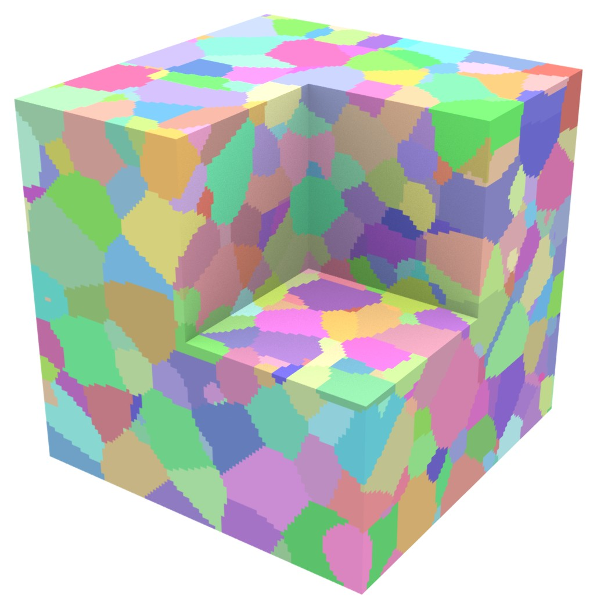

*Johnson-Mehl nucleation and growth with the rate set for 1000 grains: 1005 nuclei formed and 993
grains remained. $100^3$ hexahedra.*

In recrystallization and many solid-state transformations, grains do not all start at once. In
the **Johnson-Mehl** model, nuclei appear at random places and times at a constant rate $I$ (per
unit volume and time) and grow as spheres at speed $v$; a nucleus that would appear inside
already transformed material never forms. A point belongs to the grain that reaches it first.
Grain $i$, born at time $t_i$, arrives at $\mathbf{x}$ at time
$t_i + \lVert\mathbf{x}-\mathbf{s}_i\rVert / v$, which is the additive rule of section 5 with
head start $a_i = -v\,t_i$. Early grains grow large, late ones are squeezed in between, and the
boundaries are curved.

You do not choose the number of grains directly; it follows from the ratio $I/v$. In an infinite
body the untransformed fraction at time $t$ is the classical Johnson-Mehl-Avrami-Kolmogorov
(JMAK) result

$$
1 - X(t) = \exp\left(-\frac{\pi}{3} I v^3 t^4\right).
$$

New grains can only appear in untransformed material, so integrating the accepted nucleation rate
$I\,(1 - X(t))$ over all time gives the number of grains per unit volume:

$$
\frac{N}{V} = \int_0^\infty I\, e^{-\frac{\pi}{3} I v^3 t^4}\, dt
= \Gamma\!\left(\tfrac{5}{4}\right) \left(\frac{3}{\pi}\right)^{1/4} \left(\frac{I}{v}\right)^{3/4}
\approx 0.896 \left(\frac{I}{v}\right)^{3/4}.
$$

For about $N$ grains in a volume $V$, keep `growth_speed = 1` and set the rate to

$$
I = \left(\frac{N}{0.896\, V}\right)^{4/3},
$$

which is about 11 600 for the 1000 grains in the unit cube of the picture. A finite part gets
somewhat more grains than the formula predicts (grains at a free surface can only grow inward,
which leaves room for more nuclei), and the random scatter is about $\sqrt{N}$. `end_time` stops
nucleation early (fewer small grains) and `num_nuclei` caps the count. Johnson-Mehl decides the
sizes itself, so `num_seeds`, `[Seeds.Size]`, `fit_volumes`, `lloyd_iterations` and periodic
boxes cannot be combined with it.

```toml
[Seeds]
    placement = "johnson_mehl"
    [Seeds.JohnsonMehl]
        rate = 11600.0
        growth_speed = 1.0
[Tessellation]
    metric = "additive"
```

Options file: [`johnson_mehl.toml`](microstructure_figures/sources/johnson_mehl.toml).

### 6.5 Elongated and columnar grains

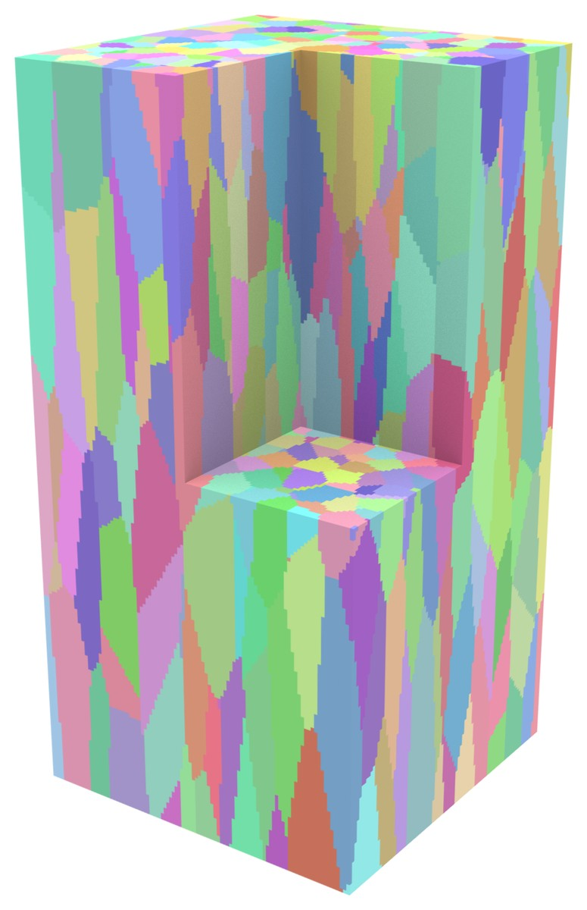

*1000 columnar grains, five times longer along $z$ than wide, in a $1 \times 1 \times 2$ bar of
$100 \times 100 \times 200$ hexahedra.*

Rolling, drawing, directional solidification and additive manufacturing all produce grains that
are longer in one direction. The quadric rule describes them with a symmetric $3\times3$ tensor
$\mathbf{A}$, written as six numbers $[A_{xx}, A_{yy}, A_{zz}, A_{yz}, A_{xz}, A_{xy}]$. For grains
$k$ times longer along a direction than across it, use $1/k^2$ on the diagonal for that direction
and 1 for the others. The picture shows the columns of an additively built part, five times longer
along the build direction $z$ than wide ($A_{zz} = 1/5^2 = 0.04$), which end inside the part:

```toml
[Seeds]
    num_seeds = 1000
    min_distance_factor = 0.4
[Tessellation]
    metric = "quadric"
    global_tensor = [1.0, 1.0, 0.04, 0.0, 0.0, 0.0]
```

Other starting points (adjust them to your micrographs):

| Microstructure | Setting |
|---|---|
| Rolled plate, pancakes about 3 : 2 : 1 along RD = $x$, TD = $y$, ND = $z$ | `global_tensor = [0.111, 0.25, 1.0, 0.0, 0.0, 0.0]` |
| Drawn wire or extruded bar along $z$, grains 4 times longer | `global_tensor = [1.0, 1.0, 0.0625, 0.0, 0.0, 0.0]` |
| Columns through the whole part (directional solidification); `num_seeds` counts columns | `anisotropy = { kind = "columnar", axis = [0.0, 0.0, 1.0] }` |
| Layers through the whole part | `anisotropy = { kind = "lamellar", normal = [0.0, 0.0, 1.0] }` |
| A different shape and direction for every grain | `anisotropy = { kind = "per_seed" }` with a seed table (section 9) |

For grains $k$ times longer along a unit vector $\mathbf{a}$ that is not a coordinate axis, use
$\mathbf{A} = \mathbf{I} - (1 - 1/k^2)\, \mathbf{a}\mathbf{a}^{\mathsf T}$. For pancakes with
half-axes $a, b, c$ along rotated directions (the columns of a rotation matrix $\mathbf{R}$), use
$\mathbf{A} = \mathbf{R}\,\mathrm{diag}(1/a^2, 1/b^2, 1/c^2)\,\mathbf{R}^{\mathsf T}$, scaled so its
largest entry is 1. Elongated grains are longer, so fewer of them fit along the long direction:
keep the part at least a few grain lengths long that way. Options file:
[`columnar.toml`](microstructure_figures/sources/columnar.toml).

### 6.6 Several phases

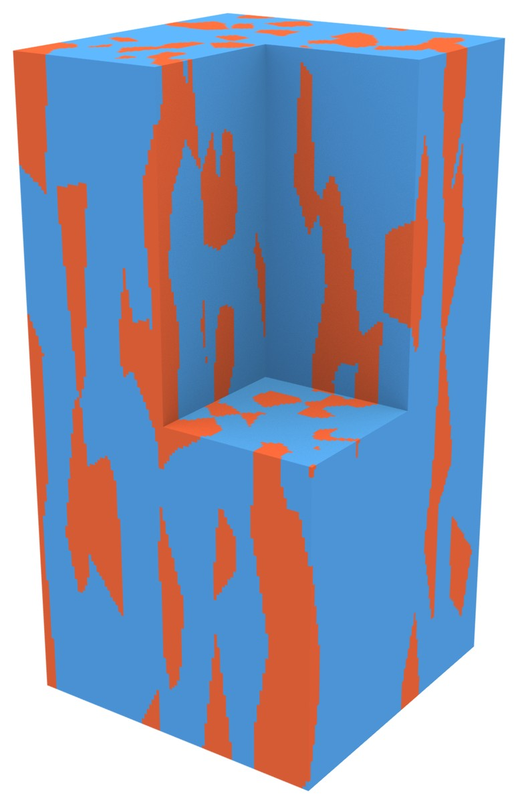

*The columnar grains of section 6.5 split into two phases by volume: phase 1 (70 %) in blue,
phase 2 (30 %) in orange-red.*

Any microstructure can hold several phases, each becoming its own ExaConstit material (a region,
section 10). Without measured phase data, `mode = "phase_fractions"` assigns phases to the grains
by volume: grains are visited in a random order, and each joins the phase that is furthest below
its target. Phases are therefore spread at random through the part, independent of grain size.
The achieved fractions match the targets to within the volume of the largest grain, so many
grains give a close match. Typical uses are two-phase alloys and studies of hard and soft grains.

```toml
[Regions]
    mode = "phase_fractions"
    phases = [{ id = 1, fraction = 0.7 }, { id = 2, fraction = 0.3 }]
```

Phase 1 becomes region 1 and phase 2 region 2, so the simulation needs two `[[Materials]]`
blocks. The table combines with any grain shape: adding it to the log-normal example of
section 6.3 gives a two-phase microstructure with a grain size distribution. All phases then
share one size distribution; phases with different grain sizes, or clustered phases, need a seed
table or voxel map that carries the phase of every grain (section 9). Options file:
[`columnar_two_phases.toml`](microstructure_figures/sources/columnar_two_phases.toml).

---

## 7. Conformal grain boundaries

Grains are made of whole elements, so their boundaries follow element faces and form stair steps.
A finer mesh makes the steps smaller. The stair steps matter most where they concentrate stress:
at grain boundaries, in thin parts and near free surfaces.

The **conformal** option smooths the boundaries on the same mesh: it moves the nodes so that the
element faces lie on the grain boundaries. The elements, their connectivity and the element type
stay the same, so boundary conditions and the rest of the simulation set-up are unchanged.

```toml
[Conformal]
    enabled = true
```

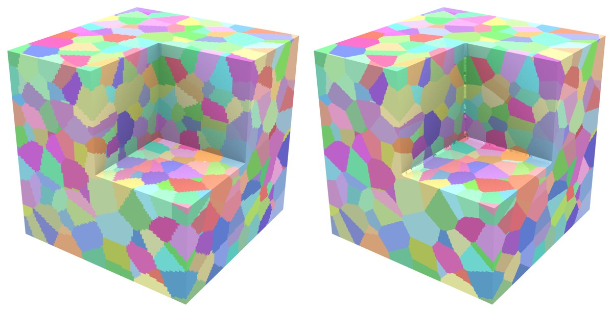

*The 1000-grain cube of section 2, cut open with flat planes. Left: grain boundaries follow
element faces. Right: after the conformal fit, which moved the grain boundary nodes from 0.41 to
0.22 element sizes from the true boundaries on average, with the worst scaled Jacobian at 0.46 and
no inverted element (options file
[`box_1000_grains_conformal.toml`](microstructure_figures/sources/box_1000_grains_conformal.toml)).*

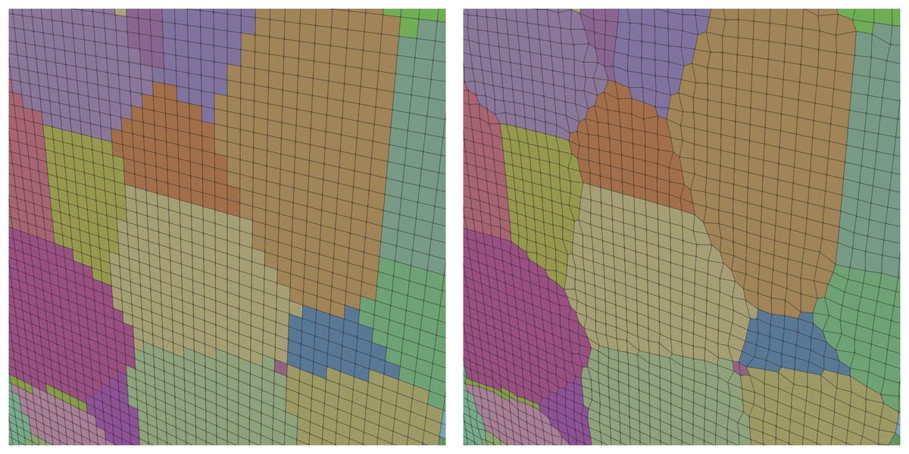

*Close-up near a corner of the same cube, with element edges drawn.*

### How the fit works

1. **Labels.** Every node learns which grains surround it. A node in one grain lies inside it;
   in two, on a grain boundary; in three, on a triple line (where three grains meet); in four, at
   a quadruple point. Nodes on the outer surface also learn which surfaces they lie on.
2. **Targets.** Every boundary node gets a target, the closest point of its grain boundary. For
   grains made by a distance rule that boundary is known exactly (for Voronoi grains, the plane
   halfway between two seeds). For grains with no formula behind them (voxel maps, geodesic
   grains) the target is a smoothed copy of the stair steps.
3. **Repair.** A few elements at awkward stair-step corners are first given to a neighboring
   grain, so that every node can reach a sensible target. This changes grain volumes by a few
   elements at most.
4. **Morph.** The mesh is treated as an elastic solid, and every boundary node is pulled toward
   its target by a spring. A linear solve balances the springs against the elastic resistance of
   the mesh, so the elements next to a boundary deform smoothly instead of collapsing.
5. **Quality control.** After each solve every element is checked against shape limits: the
   *scaled Jacobian* (how far each corner is from a right angle; 1 for a perfect cube, at least
   0.3 required), the *aspect ratio* (longest over shortest edge direction, at most 4) and, for
   tetrahedra, the *mean ratio* (how close the element is to a regular tetrahedron, at least 0.4).
   Where a limit would be broken, the nearby springs are weakened and the solve repeated. Elements
   that start near or beyond a limit may lose only a small part of their initial quality.

The outer shape of the part does not change. Nodes on outer faces slide within them, and on
axis-aligned faces the coordinate across the face is kept exactly, so boundary conditions select
the same nodes before and after the fit. Nodes on curved surfaces, and on edges where two surfaces
meet, slide along them; corners stay fixed. On second-order meshes the fit also curves the element
faces, which gives curved grain boundaries.

### What to expect

- Grain boundary nodes typically end about $0.2\,h$ from the true boundary ($h$ the element size),
  down from about $0.4\,h$ for the stair steps; second-order meshes get closer, about $0.15\,h$.
  The worst scaled Jacobian typically stays around 0.4 to 0.5.
- **Grain volumes converge** with mesh refinement, and the boundary *position* is accurate.
- **Grain boundary area does not converge.** It stays 10 to 25 % too large at every resolution
  (the stair steps are 40 to 60 % too large), because the quality limits leave a small waviness at
  the old stair corners. Quantities that scale with boundary area, such as a grain boundary
  energy, carry that error.
- Meshes with well-shaped elements fit best. The fit cannot improve a mesh whose elements are
  already near the quality limits, so it gets less far on strongly distorted meshes.
- The log reports how close the boundaries got and the worst element quality before and after;
  check both.

### Should I use it?

Use the conformal fit when the stress and strain fields *at* grain boundaries matter: boundary
stress concentrations, hard/soft phase interfaces, damage or slip transfer at boundaries, thin
parts with few elements across, and coarse meshes with fewer than a few hundred elements per
grain. For averaged responses (stress-strain curves, texture evolution) of well-resolved
microstructures, the stair steps are usually adequate and the fit adds little. The fit costs extra
generation time but none in the simulation, which runs on the same number of elements. It works on
hexahedral and tetrahedral meshes of order 1 or 2, with phases and passthrough parts, but not with
periodic boxes. After a fit, use the written mesh file (or the in-simulation route), not the grain
file.

---

## 8. Parts with holes, thin walls and lattices

In a solid part the straight-line distance (`distance = "euclidean"`, the default) is the right
measure. In a part with holes, slots, thin walls or struts, the straight line from a seed can
cross empty space, so one grain could appear on both sides of a gap, which is not physical. Two
distance modes prevent this:

- `distance = "connected"` keeps straight-line distances, but a grain keeps only the elements it
  reaches through material; pieces cut off by a gap go to the next closest seed. It is cheap,
  works with every metric, and is the right choice when grains are small compared with the holes
  and walls.
- `distance = "geodesic"` measures distance along paths that stay inside the material, so grains
  wrap around holes and corners the way growing grains would. It matters when grains are large
  compared with the features of the part, as in a lattice whose struts are a few grains thick.
  With small grains it gives the same grains as `"connected"`, with slightly rougher boundaries.

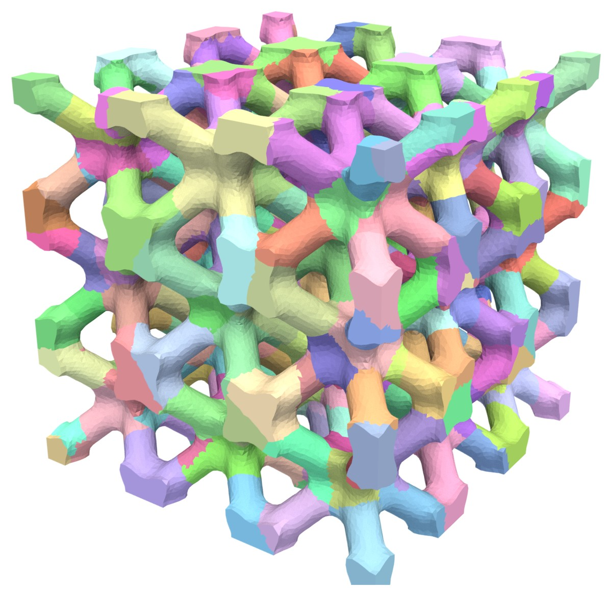

*About 300 grains in a $3 \times 3 \times 3$ cell BCC strut lattice with filleted (rounded)
junctions, meshed with about 540 000 tetrahedra (Gmsh) whose node positions were then smoothed
for element quality. Grains are grown along the struts with geodesic distance, and their
boundaries fitted with the conformal option: the boundary nodes moved from 0.36 to 0.21 element
sizes from their targets on average, with no inverted element.*

### How geodesic distance is computed

The geodesic distance $T(\mathbf{x})$ from the seeds is the arrival time of a front that starts at
every seed at once and moves through the material at unit speed. It solves the **eikonal
equation**

$$
\lVert \nabla T(\mathbf{x}) \rVert = 1 \quad \text{in the material}, \qquad T(\mathbf{s}_i) = -a_i ,
$$

where $-a_i$ is the head start of seed $i$ (zero for Voronoi grains). Every node remembers the seed
whose front reached it first, and every element joins the grain of its nodes. The default solver,
the **Fast Iterative Method** (`solver = "fim"`), solves the equation inside every element, so
paths may cut across elements; `solver = "graph"` follows element edges, which is faster but
makes paths up to about 12 % (hexahedra) or 30 % (tetrahedra) too long.

Every metric works in this mode. Stretched (quadric) grains measure paths with the stretched
length, and columnar or lamellar grains, which are infinitely long, become columns many times
longer than wide (by default long enough to run through the whole part). Laguerre grains need the
`"fim"` solver.

The options for the picture:

```toml
[Mesh]
    type = "file"
    floc = "lattice_bcc_tet_3cells.mesh"
[Seeds]
    num_seeds = 300
    min_distance_factor = 0.4
[Tessellation]
    distance = "geodesic"
[Conformal]
    enabled = true
```

The lattice meshes are made by
[`test/data/microstructure/lattice/make_lattice_meshes.py`](../test/data/microstructure/lattice/make_lattice_meshes.py)
(here `tet lattice_bcc_tet_3cells.mesh --cells 3 --size 0.05`). Options file:
[`lattice_geodesic.toml`](microstructure_figures/sources/lattice_geodesic.toml). For parts that
fill only a tiny fraction of their bounding box, the generator places seeds element by element,
so those seeds, unlike all others, change when the mesh is refined.

---

## 9. Measured or simulated data

Measured and simulated microstructures enter in one of two forms:

| Your data | How it enters | Options |
|---|---|---|
| A list of grains: far-field HEDM (HEXRD, MIDAS converters), or any table of grain positions with orientations, phases, sizes | **seed table**: grains grow from the listed positions with any metric | `[Seeds] source = "file"`, `file` |
| A 3D grid of grain numbers: near-field HEDM, DREAM.3D reconstructions of EBSD serial sections, ExaCA, SPPARKS | **voxel map**: the grid is copied onto the mesh | `[Source] type = "voxel_map"`, `[VoxelMap] file` |

In both cases `[Orientations] source = "from_source"` keeps your orientations and
`[Regions] mode = "from_phase"` turns your phases into ExaConstit materials. The mesh does not need
to match the data: a voxel map can be put onto any mesh that lies inside it, including a curved
specimen meshed with tetrahedra.

Before you start:

- **Grains, not pixels.** A voxel map holds a grain number per voxel. Raw EBSD data with one
  orientation per pixel must be segmented into grains first (for example in DREAM.3D). A single 2D
  EBSD map is not supported; build a 3D data set first.
- **Frames.** The generator never rotates data. If your sample axes do not match the mesh axes,
  rotate both the positions and the orientations in your own script first (section 10 shows the
  orientation side).
- **Units.** `units_scale` and `translate` convert data coordinates to mesh coordinates,
  $\mathbf{x}_{\mathrm{mesh}} = s\,\mathbf{x}_{\mathrm{file}} + \mathbf{t}$; for example
  `units_scale = 1.0e-3` for data in microns on a mesh in millimeters. The converters have their own
  `--units-scale`; scale in one place only.

### The ExaConstit microstructure file

Seed tables and voxel maps are stored in **ExaConstit's microstructure file**, an HDF5 file with a
simple layout:

- a **grain table**, one row per grain: the grain number and, optionally, its orientation
  (quaternion), phase, seed position, target volume, weight and shape;
- optionally a **voxel map**: the grain number of every cell of a regular grid, with the grid's
  origin and spacing.

The voxel part follows the Conduit Blueprint convention for uniform meshes, which VisIt and
other Conduit-based tools also read. Two other inputs are accepted: seed tables as CSV text (handy
for short lists written by hand, section 13.1) and DREAM.3D files, read directly with
`format = "dream3d"`. The converters in [`scripts/microstructure/`](../scripts/microstructure/)
write the microstructure file from ExaCA and SPPARKS output and write CSV seed tables from HEXRD
and MIDAS grain lists. The generator writes one for every run when asked
(`[Output] microstructure_file = "grains"`), so a generated microstructure can be put onto another
mesh later. The exact layout is in section 13.2.

### Example: a tensile bar cut from an additively built block

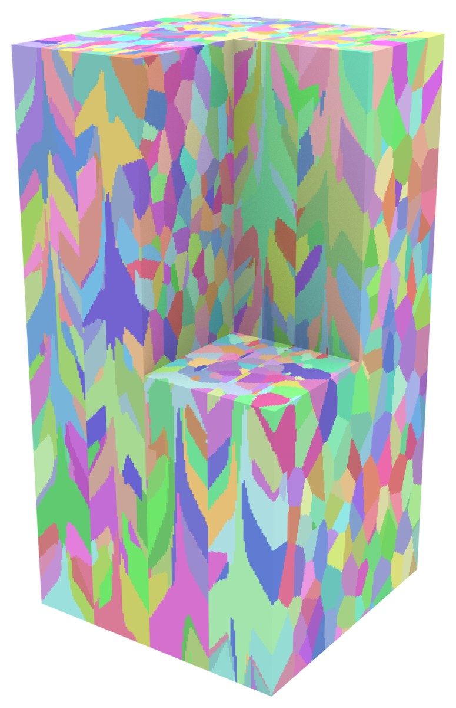

*A synthetic stand-in for 3D measured data of a part built by laser powder-bed fusion: 1500
columnar grains on a grid of $160 \times 160 \times 320$ voxels, each grain with its own
orientation. The part was built along $z$ with laser tracks along $x$, side by side in $y$;
grains grow along the build direction but tilt by up to 35° toward the centre line of each track,
which gives the chevron pattern on the faces cut across the tracks.*

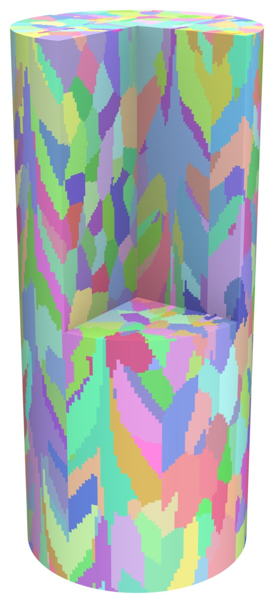

*A round tensile bar along the build direction (radius 0.35, length 1.6), meshed with about
2 million hexahedra (a square core surrounded by four blocks that follow the circle), placed
inside the block and shown with a corner cut away. Every element takes the grain of the voxels it
covers, and every grain keeps its orientation; 860 of the block's grains reach into the bar.*

**Writing the file.** The Python writer in
`scripts/microstructure/exaconstit_microstructure_io.py` needs only numpy and h5py. Put that
directory on Python's path and call `write_voxel_map` for a voxel map, or
`write_microstructure_file` for a grain table without a grid:

```python
import sys
sys.path.insert(0, "/path/to/ExaConstit/scripts/microstructure")
import exaconstit_microstructure_io as msio

# grain_ids: integer array of shape (nz, ny, nx), x varying fastest; 0 marks unindexed voxels
# h:         voxel edge length (data units)
# ids:       the grain numbers (>= 1) that appear in grain_ids, one per grain
# quats:     one orientation per grain, w x y z, crystal to sample (section 10)
# phases:    one phase (>= 1) per grain
msio.write_voxel_map("am_block.h5", grain_ids, origin=(0.0, 0.0, 0.0),
                     spacing=(h, h, h), feature_ids=ids, feature_quats=quats,
                     feature_phases=phases)
```

(`feature` is DREAM.3D's word for a grain.) The file then holds:

```text
format                            "ExaConstit microstructure"
format_version                    1
grains/id                         int64    (1500,)
grains/phase                      int32    (1500,)
grains/quat                       float64  (1500, 4)
mesh/coordsets/coords/type        "uniform"
mesh/coordsets/coords/dims/i, j, k          161, 161, 321   (grid points = voxels + 1)
mesh/coordsets/coords/origin/x, y, z        0.0, 0.0, 0.0
mesh/coordsets/coords/spacing/dx, dy, dz    0.00625, 0.00625, 0.00625
mesh/topologies/topo/type, coordset         "uniform", "coords"
mesh/fields/grain_id/association, topology  "element", "topo"
mesh/fields/grain_id/values       int64    (320, 160, 160)
provenance/source                 "synthetic additively built block, make_voxel_example.py"
```

**Using it.** The options that put the block onto the bar:

```toml
[Mesh]
    type = "file"
    floc = "round_bar.mesh"
[Source]
    type = "voxel_map"
[VoxelMap]
    format = "exaconstit"
    file = "am_block.h5"            # elements about the voxel size: the default centroid
                                    # sampling is right ("quadrature_vote" for coarser meshes)
[Orientations]
    source = "from_source"
```

The complete example is [`make_voxel_example.py`](microstructure_figures/make_voxel_example.py)
(the data and the bar mesh) with
[`round_bar_from_voxels.toml`](microstructure_figures/sources/round_bar_from_voxels.toml); the
picture of the block is drawn from the file itself with
[`voxels_to_vti.py`](microstructure_figures/voxels_to_vti.py).

Practical points:

- **Placement check.** The run summary prints the voxel grid in mesh units and how many sample
  points fell outside it. That count should be zero (or small) when the mesh lies inside the data;
  points outside take a neighbor's grain.
- **Unindexed voxels** (grain number 0 or below) belong to no grain; elements over them take a
  neighbor's grain.
- **Element and voxel size.** With elements about the voxel size or smaller, the default
  `sampling = "centroid"` is right; with elements larger than the voxels, use `"quadrature_vote"`.
- **Large data.** Each MPI process reads only the part of the grid under its own elements.

### Seed tables

A seed table lists grains rather than voxels: position, and optionally orientation, phase, size
and shape. The grains are grown with any metric of section 5, which suits far-field HEDM grain
lists (converted with `hexrd_grains_to_seeds.py` or `midas_grains_to_seeds.py`). A region of
interest (`roi`) restricts the measured grains to part of the mesh, and
`fill_outside_roi = "random"` fills the rest with synthetic grains. With a size column,
`[Seeds.Size] distribution = "from_source"` together with `metric = "laguerre"` and `fit_volumes`
makes every grain its measured size; with shape columns, `anisotropy = { kind = "per_seed" }`
gives every grain its own shape. Seed tables can also give a synthetic microstructure a texture:
write random positions with orientations sampled from your orientation distribution
(section 10).

---

## 10. Orientations, phases and materials

### Orientations

Every grain has one crystal orientation, stored as a unit **quaternion** $q = (w, x, y, z)$: four
numbers that describe a rotation by an angle $\theta$ about a unit axis $\mathbf{n}$ as
$w = \cos(\theta/2)$ and $(x, y, z) = \sin(\theta/2)\,\mathbf{n}$. In ExaConstit the quaternion
takes vectors and tensors from the crystal frame to the sample frame: with the rotation matrix

$$
\mathbf{C}(q) =
\begin{bmatrix}
w^2+x^2-y^2-z^2 & 2(xy - wz) & 2(xz + wy) \\
2(xy + wz) & w^2-x^2+y^2-z^2 & 2(yz - wx) \\
2(xz - wy) & 2(yz + wx) & w^2-x^2-y^2+z^2
\end{bmatrix},
$$

a crystal direction $\mathbf{v}_c$ has sample components $\mathbf{v}_s = \mathbf{C}\,\mathbf{v}_c$,
and a tensor maps as $\mathbf{A}_s = \mathbf{C}\,\mathbf{A}_c\,\mathbf{C}^{\mathsf T}$. This is the
convention of ExaConstit's orientation files and of ExaCMech.

**From Bunge Euler angles.** Texture analysis usually works with the Bunge orientation matrix
$\mathbf{g}$, which takes sample components to crystal components; ExaConstit's $\mathbf{C}$ is its
transpose, $\mathbf{C} = \mathbf{g}^{\mathsf T}$. For Bunge angles $(\varphi_1, \Phi, \varphi_2)$ in
radians, SciPy gives the ExaConstit quaternion directly, once its component order (scalar last) is
changed to scalar first:

```python
from scipy.spatial.transform import Rotation

x, y, z, w = Rotation.from_euler("ZXZ", [phi1, Phi, phi2]).as_quat()
q = (w, x, y, z)    # ExaConstit order: scalar first
```

To rotate data from the sample frame into the mesh frame with a rotation matrix $\mathbf{Q}$,
rotate positions as $\mathbf{Q}\,\mathbf{x}$ and orientations as $\mathbf{Q}\,\mathbf{C}$ (the
quaternion product of $\mathbf{Q}$'s quaternion with $q$).

**Random and textured orientations.** `[Orientations] source = "random"` (the default) spreads
orientations evenly over all rotations. There is no built-in texture option: sample orientations
from your orientation distribution function (for example with MTEX) and supply them in a seed
table. The orientations of a run are in `<basename>.ori` and `<basename>_grains.csv`.

### Phases and regions

A phase becomes a region (an ExaConstit material, the $r$-th `[[Materials]]` block for region
$r$). With `mode = "from_phase"` the phases present are numbered in ascending order:

| Phases in the data | Regions |
|---|---|
| 1, 2, 3 | 1, 2, 3 |
| 1 and 3 | 1 and 2 |
| 1, 3 and 7, with `phase_to_region = { "1" = 1, "3" = 1, "7" = 2 }` | 1 and 2 (phases 1 and 3 share a material) |

Phases listed in `non_crystalline_phases` (an amorphous phase, an inclusion modeled with an
isotropic material) get no rotation.

### Parts without grains

A build plate, a grip or an anvil can be kept as one undivided block with its own material. In
the mesh it is a separate element set (attribute); the generator makes grains only in the other
elements:

```toml
[Mesh]
    type = "file"
    floc = "dogbone.msh"
    active_attributes = [1]                  # the gauge section gets grains
    passthrough_attributes = { "2" = 2 }     # the grips stay one block, material 2
```

---

## 11. Running inside an ExaConstit simulation

A `[Mesh.Microstructure]` table makes the grains when the simulation starts. It takes either a
file with the generator's tables (`file = "micro.toml"`) or the tables themselves, written with
`Mesh.Microstructure.` in front of each name:

```toml
[Mesh.Microstructure.Seeds]
    num_seeds = 1000
    rng_seed = 1
    min_distance_factor = 0.5
[Mesh.Microstructure.Tessellation]
    metric = "voronoi"
```

What changes from the standalone tool:

- The mesh is the simulation's own `[Mesh]`, after refinement, so the generator's `[Mesh]` keys
  other than `active_attributes` and `passthrough_attributes` are refused.
- Leave out `grain_file`, `orientation_file`, `region_mapping_file` and `num_grains`, and keep only
  `ori_state_var_loc` and `ori_stride` in each `[Materials.Grain]`. ExaConstit stops at start-up
  with a message naming any of these left in place.
- The simulation needs one `[[Materials]]` block per region.
- The generator runs where the simulation runs, on GPUs when `[Solvers] rtmodel` selects them.
- Record files (orientations, grain table, regions) go to `results/<basename>/`. The generator's
  own ParaView output is off unless `paraview = true` (then
  `results/<basename>/<generator basename>_paraview/`); with ExaConstit's
  `[Visualizations] paraview = true`, the simulation output carries a "Grain ID" field next to
  stresses and strains.
- `[Conformal] enabled = true` moves the nodes of the simulation's mesh before the first step.
- A restarted simulation takes its grains from the checkpoint and does not run the generator again.

ExaConstit's own options (`[Materials]`, `[BCs]`, `[Solvers]`, ...) are documented in
[`src/options.toml`](../src/options.toml). A complete deck that generates its grains this way is
[`test/data/microstructure/mechanics/hook_voronoi_np2.toml`](../test/data/microstructure/mechanics/hook_voronoi_np2.toml).

For a **scatter study**, a set of runs that differ only in the random grains, make copies of the
deck that differ only in `rng_seed` (and in the top-level `basename`, so results go to separate
folders). Each copy gets a different but statistically similar set of grains and orientations.

---

## 12. Choosing options: recipes, guidance and limitations

### Recipes

| I want | Set |
|---|---|
| Equiaxed grains | `metric = "voronoi"`, `num_seeds`, `min_distance_factor = 0.5` (6.2) |
| Very uniform, rounded grains | add `lloyd_iterations = 10` (6.2) |
| A measured grain size distribution | `metric = "laguerre"`, `[Seeds.Size]`, `fit_volumes` (6.3) |
| Recrystallized-looking grains | `placement = "johnson_mehl"`, `metric = "additive"` (6.4) |
| Elongated, pancake or columnar grains | `metric = "quadric"`, `global_tensor` or `anisotropy` (6.5) |
| Two or more materials | `[Regions] mode = "phase_fractions"` or `"from_phase"` (6.6, 10) |
| Smooth grain boundaries | `[Conformal] enabled = true` (7) |
| A part with holes, thin walls or struts | `distance = "connected"` or `"geodesic"` (8) |
| My measured grains | seed table or voxel map, `[Orientations] source = "from_source"` (9) |
| Measured grains in part of the specimen only | seed table with `roi` and `fill_outside_roi = "random"` (9) |
| Grips or a build plate without grains | `[Mesh] passthrough_attributes` (10) |
| A periodic RVE | `[Tessellation] periodic = [true, true, true]` |
| Several statistically similar specimens | change `rng_seed` (11) |

### Guidance

- **Elements per grain.** Grains need enough elements for stresses and strains to vary inside
  them. Use the vote sampling below about 100 elements per grain. The pictures in this guide use
  about 1000 elements per grain, which look smooth even without the conformal fit.
- **Grains across the part.** With fewer than about 10 grains across the smallest dimension of a
  specimen (a gauge thickness, a strut), individual grains dominate the response and
  specimen-to-specimen scatter is large; that is the regime a scatter study explores.
- **Small grains.** `[Cleanup] min_grain_elements` (8 to 20 when grains average 100 elements or
  more) merges grains too small for the mesh; useful with Johnson-Mehl and wide size
  distributions.
- **Checking a run.** The log reports the number of grains made, merged or split, grain sizes in
  elements, neighbors per grain and, for the conformal fit, how close the boundaries got and the
  worst element quality. Look at the result in ParaView before running mechanics.
- **Periodic RVEs.** `periodic = [true, true, true]` makes grains continue across opposite faces
  of a box, for grain statistics without the bias of grains cut at the faces. (ExaConstit's
  mechanics has no periodic boundary conditions; only the microstructure is periodic.)

### Limitations

- No Abaqus or ANSYS mesh reader (convert through Gmsh or meshio, section 3).
- Data is never rotated; no built-in texture; no 2D EBSD maps (section 9).
- The conformal fit needs hexahedra or tetrahedra of order 1 or 2 and does not work with periodic
  boxes.
- Johnson-Mehl cannot be combined with size distributions, Lloyd relaxation or periodic boxes.

---

## 13. Reference: file formats

All lengths are in the units of the file; `units_scale` ($s$) and `translate` convert them to mesh
units. Orientations are always unit quaternions `w x y z`, crystal to sample (section 10).

### 13.1 Seed table as CSV text

Short grain lists can be written by hand or in a spreadsheet as CSV; the HEDM converters write
this form too. `[Seeds] source = "file"` reads both CSV and microstructure files and tells them
apart by their first bytes.

```text
# ExaConstit seed table v1
id, x, y, z, qw, qx, qy, qz, phase
1, 0.25, 0.25, 0.25, 1.0, 0.0, 0.0, 0.0, 1
2, 0.75, 0.25, 0.50, 0.7071068, 0.7071068, 0.0, 0.0, 1
3, 0.50, 0.75, 0.75, 0.7071068, 0.0, 0.0, 0.7071068, 2
```

- Lines starting with `#` and blank lines are comments. The first other line is the header:
  comma-separated column names, in any order and any letter case.
- Every following line is one grain, with one value per header column. Numbers use a decimal
  point; scientific notation is fine.

| Column | Required | Meaning |
|---|---|---|
| `x, y, z` | yes | seed position |
| `id` | no | grain number, unique, $\ge 1$ (default: the row number) |
| `qw, qx, qy, qz` | no (all four or none) | orientation; normalized on reading; a row whose length is off 1 by more than $10^{-3}$ is an error |
| `phase` | no | integer $\ge 1$ |
| `weight` | no | Laguerre weight or additive head start, in **mesh** units: not converted by `units_scale` |
| `volume`, `radius` or `diameter` | no (at most one) | grain size $> 0$ |
| `m11, m22, m33, m23, m13, m12` | no (all six or none) | grain shape tensor $\mathbf{M}$ (length²) |

Sizes and shapes are converted by `units_scale` (volumes by $s^3$, radii and diameters by $s$,
shapes by $s^2$); weights are not, because they are tied to the metric of the mesh. For a grain
shaped like an ellipsoid with half-axes $a, b, c$ along $x, y, z$, write $m_{11} = a^2$,
$m_{22} = b^2$, $m_{33} = c^2$ and the other three as 0 (for other directions
$\mathbf{M} = \mathbf{R}\,\mathrm{diag}(a^2, b^2, c^2)\,\mathbf{R}^{\mathsf T}$). Euler-angle and
rotation-matrix columns are refused rather than guessed: convert them to quaternions first
(section 10). Other unknown columns are ignored with a warning.

### 13.2 ExaConstit microstructure file (HDF5)

Every value is an HDF5 dataset, so the file reads the same from Python, C++ and Conduit.

| Path | Type | Size | Meaning |
|---|---|---|---|
| `format` | string | | `"ExaConstit microstructure"` |
| `format_version` | integer | 1 | readers refuse newer versions |
| `grains/id` | integer | $G$ | grain numbers, $\ge 1$, $< 2^{31}$, unique (required) |
| `grains/quat` | float | $G \times 4$ | $w, x, y, z$, crystal to sample |
| `grains/phase` | integer | $G$ | phase per grain, $\ge 1$ |
| `grains/position` | float | $G \times 3$ | seed point (needed to use the file as a seed table) |
| `grains/volume` | float | $G$ | target grain volume $> 0$ |
| `grains/weight` | float | $G$ | Laguerre or additive weight, in mesh units |
| `grains/shape` | float | $G \times 6$ | shape tensor $m_{11}, m_{22}, m_{33}, m_{23}, m_{13}, m_{12}$ |
| `mesh/coordsets/coords/type` | string | | `"uniform"` |
| `mesh/coordsets/coords/dims/i`, `j`, `k` | integer | 1 each | grid points per axis = cells + 1 |
| `mesh/coordsets/coords/origin/x`, `y`, `z` | float | 1 each | lower corner of cell (0, 0, 0) |
| `mesh/coordsets/coords/spacing/dx`, `dy`, `dz` | float | 1 each | cell edge lengths $> 0$ |
| `mesh/topologies/topo/type`, `coordset` | string | | `"uniform"`, `"coords"` |
| `mesh/fields/grain_id/association`, `topology` | string | | `"element"`, `"topo"` |
| `mesh/fields/grain_id/values` | integer | $n_z \times n_y \times n_x$ | grain number per cell; $\le 0$ = unindexed |

- Everything in `grains/` except `id` is optional; leave out what you do not have.
- **Grid order.** $x$ varies fastest, then $y$, then $z$: cell $(i, j, k)$ is `values[k, j, i]` in
  numpy. Data stored in another order must be transposed before writing. Cell $(i, j, k)$ is the
  box from $\text{origin} + (i, j, k)\cdot\text{spacing}$ to
  $\text{origin} + (i+1, j+1, k+1)\cdot\text{spacing}$.
- **Grain table and grid.** When orientations or phases are read, `grains/id` must list every grain
  number the grid uses; extra rows are fine and numbers need not be consecutive.
- Any integer or float type is accepted, and groups the reader does not know (such as
  `provenance/`) are ignored.
- **Compression.** ExaConstit's own HDF5 build has no gzip support, so the Python writer does not
  compress unless asked; `h5repack -f NONE in.h5 out.h5` removes compression from a file.

**DREAM.3D files** are read directly (`format = "dream3d"`): `FeatureIds` per voxel and the
per-grain `AvgQuats` and `Phases`. DREAM.3D stores quaternions scalar last and as sample-to-crystal
rotations, so set `quat_layout = "xyzw"` and `conjugate = true`.

### 13.3 Phase-to-region file

For data with many phases, `[Regions] phase_to_region_file` names a text file with one
`phase region` pair of integers per line (the layout of ExaConstit's `region_mapping_file`); lines
starting with `#` are skipped. It replaces the inline `phase_to_region`.

### 13.4 Files the standalone tool writes

With `<b>` the output directory and basename:

| File | Contents |
|---|---|
| `<b>.mesh` or `<b>.mesh.gz` | MFEM mesh; element attribute = grain number $1 \dots N$, boundary attributes kept from the input mesh |
| `<b>.mesh.000000`, ... | the same mesh split into one file per part (`mesh_format = "parallel"`), for ExaConstit's parallel mesh input |
| `<b>.grains` | one grain number per element in ExaConstit's auto-mesh order, for `grain_file` (auto box meshes, not after a conformal fit) |
| `<b>.ori` | one `w x y z` line per grain, for `orientation_file` |
| `<b>.regions` | one `grain region` line per grain, for `region_mapping_file` (with two or more regions) |
| `<b>_grains.csv` | grain table: grain number, orientation, region, element count, volume, center, number of neighbors, and phase and target volume when they apply |
| `<b>_adjacency.csv` | one row per pair of touching grains with their shared area (`grain_adjacency = true`) |
| `<b>.h5` | microstructure file of the result (`microstructure_file = "grains"`) |
| `<b>_paraview/` | ParaView collection (`.pvd`) with the field `grain_id` |

Passthrough parts become the last grain numbers $N+1, N+2, \dots$, so `grain_id > N` selects them
in ParaView.

---

## 14. References

- W. A. Johnson, R. F. Mehl, "Reaction kinetics in processes of nucleation and growth",
  *Trans. AIME* 135 (1939) 416–442.
- M. Avrami, "Kinetics of phase change. I. General theory", *J. Chem. Phys.* 7 (1939)
  1103–1112, doi:10.1063/1.1750380.
- A. N. Kolmogorov, "On the statistical theory of metal crystallization" (in Russian), *Izv.
  Akad. Nauk SSSR, Ser. Mat.* 1 (1937) 355–359.
- F. Aurenhammer, "Power diagrams: properties, algorithms and applications", *SIAM J. Comput.*
  16 (1987) 78–96, doi:10.1137/0216006.
- Q. Du, V. Faber, M. Gunzburger, "Centroidal Voronoi tessellations: applications and
  algorithms", *SIAM Rev.* 41 (1999) 637–676, doi:10.1137/S0036144599352836.
- W.-K. Jeong, R. T. Whitaker, "A fast iterative method for eikonal equations", *SIAM J. Sci.
  Comput.* 30 (2008) 2512–2534, doi:10.1137/060670298.
- Z. Fu, R. M. Kirby, R. T. Whitaker, "A fast iterative method for solving the eikonal equation
  on tetrahedral domains", *SIAM J. Sci. Comput.* 35 (2013) C473–C494, doi:10.1137/120881956.
