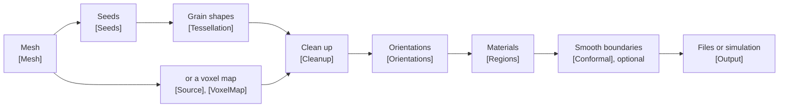
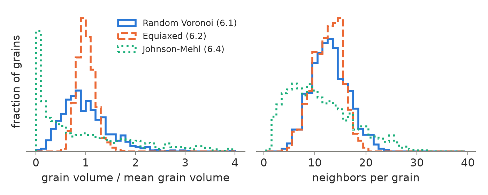
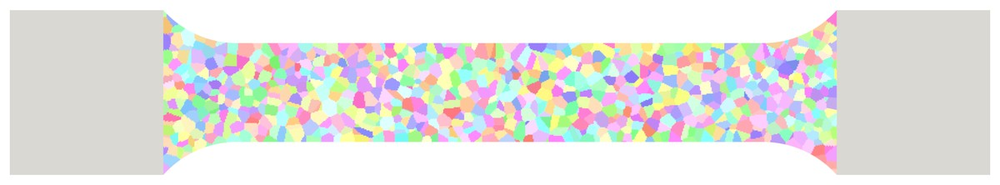
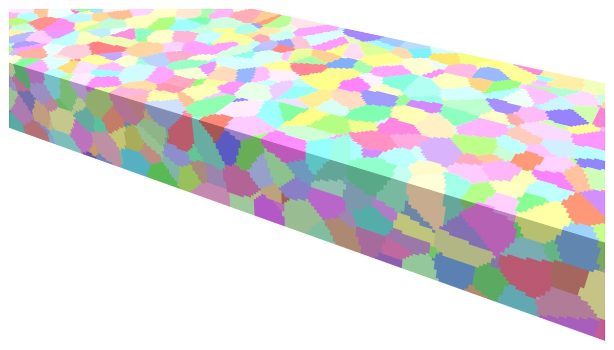
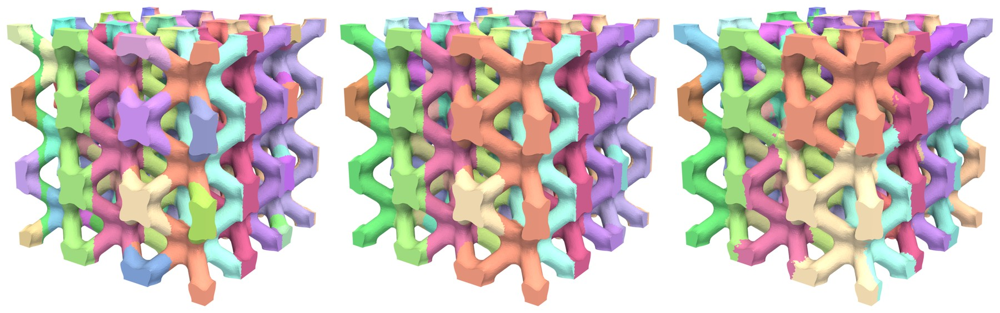

# Generating grain microstructures in ExaConstit

ExaConstit's crystal plasticity models need to know which grain every element belongs to and how
that grain's crystal is oriented. The **microstructure generator** builds that information
directly on your finite element mesh. It places grains in any mesh ExaConstit reads (hexahedra,
tetrahedra, wedges, curved high-order elements) and gives every grain a crystal orientation and a
material. On hexahedral and tetrahedral meshes it can also move the nodes so that element faces
follow the grain boundaries instead of forming stair steps. It works the same way for an
idealized cube of grains, a tensile specimen, a lattice structure or measured 3D data.

<p align="center">
  
</p>

**Figure 1.** 1000 equiaxed grains (about as wide in every direction) in a unit cube meshed with
$100^3$ hexahedra, about 1000 elements per grain. Each grain has its own color; a corner is cut
away to show the grains inside.

This guide shows what the generator can make, which options produce each kind of microstructure,
and the ideas behind them. Every option is documented in full, with its default and accepted
values, in [`src/microstructure_options.toml`](../src/microstructure_options.toml); this guide
names only the keys each feature needs. Section 4 explains the terms used throughout. How the
code is organized is described in the
[microstructure developer guide](microstructure_developers.md).

| If you... | Read |
|---|---|
| are new to generating grains | 1, 2, 5 and 6, then 11 to run a simulation |
| have a specimen or part mesh from an FE mesher | 3, 8 and 7 |
| have measured or simulated 3D data (EBSD, HEDM, ExaCA, DREAM.3D) | 9, 10 and 13 |
| plan production runs or scatter studies | 11 and 12 |

## Contents

1. [Two ways to run it](#1-two-ways-to-run-it)
2. [A first microstructure](#2-a-first-microstructure)
3. [Your own mesh, units and grain size](#3-your-own-mesh-units-and-grain-size)
4. [Words used in this guide](#4-words-used-in-this-guide)
5. [How grains are made](#5-how-grains-are-made)
6. [A gallery of microstructures](#6-a-gallery-of-microstructures)
7. [Conformal grain boundaries](#7-conformal-grain-boundaries)
8. [Specimens, holes, thin walls and lattices](#8-specimens-holes-thin-walls-and-lattices)
9. [Measured or simulated data](#9-measured-or-simulated-data)
10. [Orientations, phases and materials](#10-orientations-phases-and-materials)
11. [Running inside an ExaConstit simulation](#11-running-inside-an-exaconstit-simulation)
12. [Choosing options: recipes, guidance and limitations](#12-choosing-options-recipes-guidance-and-limitations)
13. [Reference: file formats](#13-reference-file-formats)
14. [References](#14-references)

---

## 1. Two ways to run it

### 1.1 The standalone tool and the in-simulation route

The generator comes in two forms. Both read the same options and, on the same mesh, make the same
grains, and the result never depends on the number of MPI processes.

- **The standalone tool** `microstructure_generator`, built next to `mechanics` in the `bin/`
  directory of the build. It reads a mesh (or makes a box), writes the mesh with its grains, the
  orientation file and a ParaView view, and needs no simulation set-up. **Start here** to look at
  grains and tune options; it is also the way to save a microstructure that several simulations
  share.
- **Inside a simulation.** A `[Mesh.Microstructure]` table in an ExaConstit options file makes
  ExaConstit build the grains in memory on its own mesh when the simulation starts, so no grain
  file, orientation file or region map is needed. This is the convenient route for production
  runs and for scatter studies, where every run needs a new random set of grains (section 11).

### 1.2 Running the tool

To run the standalone tool, give it an options file. It runs in parallel with MPI, like
`mechanics`; for one process, `mpirun -np 1` or no `mpirun` at all:

```bash
mpirun -np 6 microstructure_generator -i my_grains.toml
```

A few command-line flags override the options file: `-m FILE` (mesh file), `-n N` (number of
random grains), `-s S` (`rng_seed`), `-o NAME` (output basename) and `--parts P` (also write the
mesh split into `P` files for parallel reading). For example, `-s 2 -o variant_2` makes a second,
statistically similar set of grains from the same file.

### 1.3 Building and hardware

The generator is part of the build when ExaConstit is configured with `ENABLE_MICROSTRUCTURE=ON`
(the default). It needs the Axom library; if Axom is not found, CMake turns the generator off
with a message, and neither the tool nor `[Mesh.Microstructure]` is available. The tool computes
on the CPU by default; the top-level key `exec = "openmp"` or `"gpu"` uses OpenMP threads or a GPU
when ExaConstit was built with them. Inside a simulation the generator follows `[Solvers]
rtmodel`.

## 2. A first microstructure

### 2.1 The options file

The options file below makes the 1000 equiaxed grains of Figure 1
([`box_1000_grains.toml`](microstructure_figures/sources/box_1000_grains.toml)). Every key left
out keeps its default; `num_seeds` (the number of grains) is the one key without a default.

```toml
[Mesh]
    type = "auto"                # a box of hexahedra, like ExaConstit's own auto mesh
    [Mesh.Auto]
        length = [1.0, 1.0, 1.0]
        ncuts = [100, 100, 100]  # elements along x, y, z

[Seeds]
    num_seeds = 1000             # one seed per grain
    rng_seed = 1                 # another value gives another, statistically similar, set
    min_distance_factor = 0.5    # keeps seeds apart, for realistic equiaxed grains

[Tessellation]
    metric = "voronoi"

[Output]
    basename = "box_1000"
    paraview = true
```

### 2.2 What the tool writes

| File | Contents |
|---|---|
| `box_1000.mesh.gz` | the mesh, with the grain number of every element |
| `box_1000.grains` | the grain number of every element of the auto box, one per line |
| `box_1000.ori` | one orientation per grain (random unless you supply your own, section 10) |
| `box_1000_grains.csv` | one row per grain: orientation, element count, volume, center, neighbors |
| `box_1000_paraview/box_1000_paraview.pvd` | a ParaView view; open it and color by `grain_id` |

### 2.3 Using the result in a simulation

The end of the log says how to use these files in an ExaConstit simulation, for example:

```text
To use them in your own ExaConstit options file (...):
  [Mesh] type = "file", floc = "./box_1000.mesh.gz"
  or [Mesh] type = "auto" with [Mesh.Auto] length = [1, 1, 1], ncuts = [100, 100, 100]
     and top-level grain_file = "./box_1000.grains"
  one [[Materials]] block (single region; no region mapping file needed) with
    [Materials.Grain] ori_type = "quat", ori_stride = 4, num_grains = 1000,
                      orientation_file = "./box_1000.ori"
```

(The log prints each of these on one line; they are wrapped here.) Either the mesh file or the
auto box with the grain file works; after a conformal fit (section 7) only the mesh file carries
the moved nodes. Copy `num_grains` from this log (or count the rows of `box_1000_grains.csv`), not
from `num_seeds`: the final count can be lower when a seed owns no element or when small grains
are merged. Keep `ori_state_var_loc` and `ori_stride` as in your crystal plasticity deck; they are
explained in [`src/options.toml`](../src/options.toml), and
[`hook_voronoi_np2.toml`](../test/data/microstructure/mechanics/hook_voronoi_np2.toml) is a
complete small deck to start from (it makes its grains inside the simulation, section 11).

### 2.4 Smaller runs and other box shapes

This example has $10^6$ elements. For a quick first look, a box of $30^3$ elements with
`num_seeds = 100` (about 270 elements per grain) is enough; section 12.2 helps choose the
resolution for the simulation itself. Keep the elements close to cubes: a $2 \times 1 \times 1$
bar with the element and grain size of this example has `length = [2.0, 1.0, 1.0]`,
`ncuts = [200, 100, 100]` and `num_seeds = 2000`.

## 3. Your own mesh, units and grain size

### 3.1 Mesh files

The generator and ExaConstit read the mesh formats MFEM reads: MFEM (`.mesh`, `.mesh.gz`), Gmsh
(`.msh`, versions 2.2 and 4.1), VTK (legacy `.vtk` and XML `.vtu`), Netgen, TrueGrid, and
Cubit/Exodus (with MFEM built with NetCDF). There is no Abaqus (`.inp`) or ANSYS reader: export
the mesh to Gmsh or VTK first, with Gmsh or Python's `meshio` package. Hexahedra, tetrahedra,
wedges and curved (high-order) elements all work; the conformal fit (section 7) needs hexahedra or
tetrahedra of order 1 or 2.

```toml
[Mesh]
    type = "file"
    floc = "my_specimen.msh"
```

### 3.2 Element sets

Element sets become numbered *element attributes*: a Gmsh physical volume group's number, or a
VTK cell array named `material` or `attribute`. Note which number is which set (for example
gauge = 1, grips = 2): `active_attributes` limits the grains to some sets, and
`passthrough_attributes` keeps other sets as single blocks with their own material (section 8.1
shows a tensile specimen).

> **Note.** After generation the element attributes of the written mesh hold grain numbers; your
> element-set numbers are gone. Boundary attributes (the face sets used for boundary conditions)
> are kept.

### 3.3 Units

The generator has no units: every length (box size, grain size, distances) is in the units of the
mesh coordinates. ExaConstit does not fix a length unit either; only the lengths you give it (the
mesh, velocity boundary conditions) must use the mesh unit. A unit cube is 1 mm on a side if you
decide that the mesh is in millimeters.

### 3.4 From grain size to grain count

A grain of equivalent diameter $d$ (the diameter of the sphere with the same volume) has volume
$\pi d^3 / 6$, so a part of volume $V$ holds about

$$
N \approx \frac{6\,V}{\pi\, d^3}
$$

grains. For example, a $2 \times 1 \times 1$ mm bar with 50 µm grains holds about
$6 \cdot 2 / (\pi \cdot 0.05^3) \approx 30{,}000$ grains. Elongated grains of the same volume count
the same; use the equivalent diameter of the measured grain volume. The generator can also work
out the count from a mean diameter (section 6.3).

## 4. Words used in this guide

| Term | Meaning |
|---|---|
| Grain | one crystal; every element belongs to exactly one grain |
| Grain number | a grain's identifier, 1, 2, 3, ...; the field `grain_id` in the ParaView output (ExaConstit's own output calls it "Grain ID") |
| Seed | the point a grain grows from; one seed makes one grain |
| `rng_seed` | the number that fixes the random-number sequence, so a run can be repeated exactly; another value gives a different, statistically similar microstructure |
| Metric | the rule that measures which seed is "closest" to a point; it sets the grain shapes (section 5) |
| Tessellation | the division of the part into grains, one per seed (Voronoi, Laguerre, ...) |
| Equiaxed | grains about as wide in every direction, as in an annealed metal |
| Columnar | grains much longer along one direction, as in directionally solidified or additively built material |
| Orientation | the rotation of a grain's crystal lattice relative to the specimen, stored as a quaternion (four numbers describing a rotation, section 10) |
| Texture | a preferred distribution of orientations; random orientations mean no texture |
| Phase | a constituent of the material with its own crystal structure or composition: matrix and precipitate, or two alloy phases. Numbered from 1 |
| Region | an ExaConstit material: region $r$ uses the $r$-th `[[Materials]]` block. Phases become regions (section 10) |
| Element attribute (element set) | the number an element carries in the mesh file; after generation, its grain number |
| Passthrough part | an element set kept as one block without grains, with its own material (grips, a build plate) |
| Staircase (stair steps) | grain boundaries made of element faces, before a conformal fit |
| Conformal fit | moving the mesh nodes so element faces follow the grain boundaries (section 7) |
| Periodic box | a box whose grains continue across opposite faces, like a tile of an infinite material (section 5.5) |
| Voxel map | a 3D image of a microstructure: a regular grid of small boxes (voxels, the 3D form of pixels), each holding a grain number |
| Seed table | a list of grains, one row each: position and optionally orientation, phase, size, shape |
| Microstructure file | ExaConstit's HDF5 file for grain data: a list of grains (its `grains/` group) and, optionally, a voxel map (section 9.4) |
| Grain table | the per-grain list `<basename>_grains.csv` the tool writes (section 13.4); not to be confused with the `grains/` group of a microstructure file |
| Options file | the TOML file of options. "Deck" means a complete ExaConstit simulation options file |
| Auto box | a box mesh of hexahedra that the generator (or ExaConstit) builds itself (`[Mesh] type = "auto"`) |
| RVE | representative volume element: a cube of material meant to behave like the bulk |
| RD, TD, ND | rolling, transverse and normal directions of a rolled plate |
| EBSD, HEDM | electron backscatter diffraction (surface orientation maps; serial sections give 3D) and high-energy X-ray diffraction microscopy (grains inside a specimen; far-field gives a grain list, near-field a 3D map) |
| DREAM.3D, ExaCA, SPPARKS | software that reconstructs or simulates 3D microstructures: EBSD reconstruction and synthetic generation, solidification of additively manufactured material, grain growth |
| HEXRD, MIDAS | software that turns far-field HEDM measurements into grain lists |
| MPI process (rank) | one of the parallel processes a run uses |

## 5. How grains are made

Every run follows the same sequence; the tables of the options file are named after its steps.



### 5.1 Seeds

A grain grows from a **seed**. Seeds can be completely random (a *Poisson process*: every
position equally likely, independent of the others), kept a minimum distance apart
(`min_distance_factor`), placed on a regular pattern of points (`placement = "lattice"`, for
idealized studies), created over time by a nucleation model (section 6.4), or read from a table
of measured grains (section 9). `rng_seed` fixes the random-number sequence, so every run is
reproducible.

Seeds go inside the part by default. `sampling_domain = "bbox"` lets them fall anywhere in the
part's bounding box, so grains reach in from outside and surface grains are cut by the surface,
as in a specimen machined out of a larger piece. `boundary_clearance` keeps seeds away from the
surface, and `sampling_box` confines them to a box. For parts that fill less than 0.01% of their
bounding box, the generator places seeds element by element (`placement = "element_weighted"`);
only those seeds change when the mesh is refined.

### 5.2 Distance rules (the metric)

Each point of the part belongs to the seed that is "closest" to it, and the rule that measures
"closest", the **metric**, decides the grain shapes. With $\mathbf{x}$ a point and
$\mathbf{s}_i$ the position of seed $i$:

| `metric` | Point $\mathbf{x}$ belongs to the seed with the smallest | Grains |
|---|---|---|
| `"voronoi"` | $\lVert \mathbf{x}-\mathbf{s}_i \rVert$ | flat faces halfway between neighboring seeds |
| `"laguerre"` | $\lVert \mathbf{x}-\mathbf{s}_i \rVert^2 - w_i$ | flat faces; a larger weight $w_i$ gives a larger grain |
| `"additive"` | $\lVert \mathbf{x}-\mathbf{s}_i \rVert - a_i$ | curved faces; a seed with a head start $a_i$ grows further |
| `"quadric"` | $(\mathbf{x}-\mathbf{s}_i)^{\mathsf T} \mathbf{A}_i\, (\mathbf{x}-\mathbf{s}_i) - w_i$ | elongated, flattened or columnar grains |

The **Voronoi** rule is the classical model of a polycrystal whose grains all started growing at
the same time and speed. **Laguerre** (also called a *power diagram*; Aurenhammer, 1987) adds one
weight $w_i$ per grain, a squared length, and is the natural way to control grain sizes while
keeping flat faces. The **additive** rule describes grains that started growing at different
times (Johnson-Mehl); the head start $a_i$ is a length. The **quadric** rule uses a stretched
distance: where the tensor $\mathbf{A}_i$ is small along a direction, distances along it count
less and grains grow longer that way; its optional weight $w_i$ comes from a seed table. All
lengths are in mesh units.

### 5.3 From grains to elements

A grain boundary rarely follows element faces, so an element cut by a boundary must choose one
grain. With `sampling = "centroid"` (the default) it takes the grain at its center. With
`sampling = "quadrature_vote"` (vote sampling) it is divided into $8^{n}$ small pieces
($n$ = `vote_levels`, default 2) and takes the grain that holds most of its volume, which gives
more accurate grain volumes and fewer odd elements sticking out of grains. Vote sampling is worth
it when grains have fewer than about 100 elements, on tetrahedral meshes and on curved elements.
`vote_levels = 1` is less accurate than centroid sampling; use 2 or more.

### 5.4 Clean-up, orientations and materials

After labeling, the **clean-up** step makes every grain one connected piece of elements (a grain
cut in two by a hole becomes two grains or joins a neighbor) and can merge grains too small for the
mesh to represent (`[Cleanup] min_grain_elements`, off by default). Every grain then gets a
crystal **orientation** (random, or from your data) and a **region**, the ExaConstit material it
uses. Finally the optional **conformal fit** moves the mesh nodes so that element faces follow the
true grain boundaries (section 7).

### 5.5 Periodic boxes

`[Tessellation] periodic = [true, true, true]` makes grains continue across opposite faces of a
box, like a tile of an infinite material, for grain statistics without the bias of grains cut at
the faces. The mesh needs matching faces on opposite sides, which every auto box has. ExaConstit's
mechanics has no periodic boundary conditions; only the microstructure is periodic. Several
options cannot be combined with periodic boxes (section 12.3).

---

## 6. A gallery of microstructures

Every picture in this section shows about 1000 grains on a mesh of at least $100^3$ hexahedra
(1000 to 2000 elements per grain), with a corner cut away. Each grain has a random color, which
only tells neighbors apart; Figure 8 colors by phase instead. The full options file of each
picture is linked under it; the snippets show only the keys that make the difference. Section 6.5
compares the grain statistics of the first three kinds. The pictures were rendered with ParaView
by [`render_grains.py`](microstructure_figures/render_grains.py).

### 6.1 Random Voronoi grains

<p align="center">
  
</p>

**Figure 2.** 1000 Voronoi grains from completely random seeds, $100^3$ hexahedra.

Completely random seeds give the **Poisson-Voronoi** structure, the textbook random polycrystal.
Its grain sizes vary widely: seeds that land close together make small, sliver-like grains next to
large ones, a wider spread than in most annealed metals.

```toml
[Seeds]
    num_seeds = 1000
[Tessellation]
    metric = "voronoi"
```

Options file: [`voronoi_random.toml`](microstructure_figures/sources/voronoi_random.toml).

### 6.2 Equiaxed grains

<p align="center">
  
</p>

**Figure 3.** 1000 equiaxed grains: seeds kept apart, then three Lloyd steps. $100^3$ hexahedra.

Keeping seeds a minimum distance apart removes the slivers and gives the even, equiaxed grains of
an annealed metal; Figure 1 is this set-up without Lloyd steps. `min_distance_factor` is that
distance as a fraction of the average seed spacing $(V/N)^{1/3}$, with $V$ the part volume and
$N$ the number of seeds; 0.3 to 0.6 is typical. **Lloyd relaxation** (Du, Faber and Gunzburger,
1999) goes further: each step moves every seed to the center of its grain, so the grains become
rounder and more alike. One to three steps, as in the picture, give a mild effect; ten or more
give an almost regular, foam-like structure.

```toml
[Seeds]
    num_seeds = 1000
    min_distance_factor = 0.5
[Tessellation]
    metric = "voronoi"
    lloyd_iterations = 3
```

Options file: [`equiaxed.toml`](microstructure_figures/sources/equiaxed.toml).

### 6.3 A prescribed grain size distribution

<p align="center">
  
</p>

**Figure 4.** 1000 Laguerre grains whose equivalent diameters follow a log-normal distribution
($\sigma = 0.5$), $100^3$ hexahedra.

Measured grain sizes are usually well described by a **log-normal** distribution: the logarithm of
the equivalent diameter $d$ is normally distributed with standard deviation $\sigma$. About two
thirds of the grains have a diameter within a factor $e^{\sigma}$ of the median. Values of $\sigma$
between 0.3 and 0.5 are common for annealed metals. If your measurement reports the coefficient of
variation $\mathrm{CV}$ of the diameter, use $\sigma = \sqrt{\ln(1 + \mathrm{CV}^2)}$.

The generator draws a target volume for every grain, places the seeds so that big grains get more
room (`polydisperse_placement`), and adjusts the Laguerre weights $w_i$ until every grain has its
target volume within `tolerance` (`fit_volumes`). The grain faces stay flat; on the mesh they
appear as stair steps, like all grain boundaries without the conformal fit (section 7).

```toml
[Seeds]
    num_seeds = 1000
    [Seeds.Size]
        distribution = "lognormal"
        sigma = 0.5
        polydisperse_placement = true
[Tessellation]
    metric = "laguerre"
    fit_volumes = { enabled = true, tolerance = 0.03, max_iterations = 200, samples = "quadrature" }
```

Instead of `num_seeds`, `[Seeds.Size] mean_diameter` (the mean equivalent diameter) sets the size,
and the number of grains follows from the part volume.

A grain of $n$ elements can only match its target to about $1/n$, so tight tolerances and wide
distributions need finer meshes, in which the smallest grains still have enough elements. If you
set `[Cleanup] min_grain_elements`, it merges the smallest grains into their neighbors; either
way, check the achieved sizes in `<basename>_grains.csv`. Options file:
[`laguerre_lognormal.toml`](microstructure_figures/sources/laguerre_lognormal.toml).

### 6.4 Nucleation and growth (Johnson-Mehl)

<p align="center">
  
</p>

**Figure 5.** Johnson-Mehl nucleation and growth with the rate set for 1000 grains, $100^3$
hexahedra; 993 grains remain (12 late nuclei were too small to own an element).

In recrystallization and many solid-state transformations, grains do not all start at once. In
the **Johnson-Mehl** model, nuclei appear at random places and times at a constant rate $I$ (per
unit volume and time) and grow as spheres at speed $v$; a nucleus that would appear inside
already transformed material never forms (Johnson and Mehl, 1939; Avrami, 1939; Kolmogorov,
1937). A point belongs to the grain that reaches it first. Grain $i$, born at time $t_i$, arrives
at $\mathbf{x}$ at time $t_i + \lVert\mathbf{x}-\mathbf{s}_i\rVert / v$, which is the additive
rule of section 5.2 with $a_i = -v\,t_i$, so a grain born later starts behind. Early grains grow
large and late ones are squeezed in between, so the sizes spread more than for Voronoi grains
(section 6.5). The boundaries are curved (sheets of hyperboloids), though only gently at this
grain size, so in the picture the stair steps hide most of the curvature.

You do not choose the number of grains directly; it follows from the ratio $I/v$. For about $N$
grains in a volume $V$, keep `growth_speed = 1` and set the rate to

$$
I = \left(\frac{N}{0.896\, V}\right)^{4/3},
$$

which is about 11,600 for the 1000 grains in the unit cube of the picture.

<details>
<summary>Where the formula comes from</summary>

In an infinite body the untransformed fraction at time $t$ is the classical
Johnson-Mehl-Avrami-Kolmogorov (JMAK) result

$$
1 - X(t) = \exp\left(-\frac{\pi}{3} I v^3 t^4\right).
$$

New grains can only appear in untransformed material, so integrating the accepted nucleation rate
$I\,(1 - X(t))$ over all time gives the number of grains per unit volume:

$$
\frac{N}{V} = \int_0^\infty I\, e^{-\frac{\pi}{3} I v^3 t^4}\, dt
= \Gamma\!\left(\tfrac{5}{4}\right) \left(\frac{3}{\pi}\right)^{1/4} \left(\frac{I}{v}\right)^{3/4}
\approx 0.896 \left(\frac{I}{v}\right)^{3/4}.
$$

</details>

A finite part gets a few more grains than the formula predicts: near a free surface less material
lies within reach of earlier grains, so it stays untransformed longer and collects more nuclei.
The grain count varies by about $\sqrt{N}$ from one `rng_seed` to the next. `end_time` stops
nucleation early (fewer small grains) and `num_nuclei` caps the count. Johnson-Mehl decides the
sizes itself, so `num_seeds` and the seed-distance keys are ignored; section 12.3 lists the
options it cannot be combined with.

```toml
[Seeds]
    placement = "johnson_mehl"
    [Seeds.JohnsonMehl]
        rate = 11600.0
        growth_speed = 1.0
[Tessellation]
    metric = "additive"
```

Options file: [`johnson_mehl.toml`](microstructure_figures/sources/johnson_mehl.toml).

### 6.5 Grain statistics compared

The three kinds of grains above differ most in their statistics. Figure 6 and the table compare
them, from the `<basename>_grains.csv` of each run.

<p align="center">
  
</p>

**Figure 6.** Grain volume relative to the mean (left) and number of neighbors per grain (right)
for the runs of Figures 2, 3 and 5. All grains are counted, including those cut by the cube faces;
14 Johnson-Mehl grains larger than 4 times the mean lie beyond the left plot.

| Run | Grains | Coefficient of variation of the volume | 5% / 95% of volume, relative to the mean | Mean neighbors |
|---|---|---|---|---|
| Random Voronoi (6.1) | 1000 | 0.47 | 0.35 / 1.87 | 12.9 |
| Equiaxed (6.2) | 1000 | 0.18 | 0.72 / 1.30 | 12.5 |
| Johnson-Mehl (6.4) | 993 | 1.06 | 0.01 / 3.23 | 11.2 |

Keeping seeds apart and relaxing them narrows the volume distribution to less than half the spread
of random seeds. Johnson-Mehl grains spread the most: many late, small grains with few neighbors
and a long tail of early, large ones. The script
[`grain_statistics.py`](microstructure_figures/grain_statistics.py) makes this comparison for any
runs.

### 6.6 Elongated and columnar grains

<p align="center">
  
</p>

**Figure 7.** 1000 columnar grains, five times longer along $z$ than wide, in a
$1 \times 1 \times 2$ bar of $100 \times 100 \times 200$ hexahedra.

Rolling, drawing, directional solidification and additive manufacturing all produce grains that
are longer in one direction. The quadric rule describes them with a symmetric $3\times3$ tensor
$\mathbf{A}$, written as six numbers $[A_{xx}, A_{yy}, A_{zz}, A_{yz}, A_{xz}, A_{xy}]$
(`[Tessellation] global_tensor`). For grains $k$ times longer along a direction than across it,
use $1/k^2$ on the diagonal for that direction and 1 for the others. Directions are those of the
mesh coordinates, so align the mesh (or the tensor) with the specimen. Figure 7 shows the columnar
grains of an additively built part, five times longer along the build direction $z$ than wide
($A_{zz} = 1/5^2 = 0.04$). Unlike `anisotropy kind = "columnar"` below, these grains have a finite
length and end inside the part.

```toml
[Seeds]
    num_seeds = 1000
    min_distance_factor = 0.4
[Tessellation]
    metric = "quadric"
    global_tensor = [1.0, 1.0, 0.04, 0.0, 0.0, 0.0]
```

Other starting points (adjust them to your micrographs); the `anisotropy` key is also in
`[Tessellation]`:

| Microstructure | Setting |
|---|---|
| Rolled plate, pancakes about 3 : 2 : 1 along RD = $x$, TD = $y$, ND = $z$ | `global_tensor = [0.111, 0.25, 1.0, 0.0, 0.0, 0.0]` |
| Drawn wire or extruded bar along $z$, grains 4 times longer | `global_tensor = [1.0, 1.0, 0.0625, 0.0, 0.0, 0.0]` |
| Columns through the whole part (directional solidification); `num_seeds` counts columns | `anisotropy = { kind = "columnar", axis = [0.0, 0.0, 1.0] }` |
| Layers through the whole part | `anisotropy = { kind = "lamellar", normal = [0.0, 0.0, 1.0] }` |
| A different shape and direction for every grain | `anisotropy = { kind = "per_seed" }` with a seed table (section 9) |

For grains $k$ times longer along a unit vector $\mathbf{a}$ that is not a coordinate axis, use
$\mathbf{A} = \mathbf{I} - (1 - 1/k^2)\, \mathbf{a}\mathbf{a}^{\mathsf T}$. For any ellipsoidal
grain shape with half-axes $\ell_1, \ell_2, \ell_3$ along rotated directions (the columns of a
rotation matrix $\mathbf{R}$), use

$$
\mathbf{A} = \mathbf{R}\, \mathrm{diag}(1/\ell_1^2, 1/\ell_2^2, 1/\ell_3^2)
\, \mathbf{R}^{\mathsf T},
$$

scaled so its largest entry is 1; only the shape matters here, because `num_seeds` sets the size.
Elongated grains are longer, so fewer of them fit along the long direction: keep the part at
least a few grain lengths long that way. Options file:
[`columnar.toml`](microstructure_figures/sources/columnar.toml).

### 6.7 Several phases

<p align="center">
  
</p>

**Figure 8.** The columnar grains of Figure 7 split into two phases by volume: phase 1 (70%) in
blue, phase 2 (30%) in orange-red. Each phase has one color, so boundaries between grains of the
same phase do not show.

Any microstructure can hold several phases, each becoming its own ExaConstit material (a region,
section 10.4). Without measured phase data, `mode = "phase_fractions"` assigns phases to the
grains by volume: grains are visited in a random order, and each joins the phase that is furthest
below its target. Phases are therefore spread at random through the part, independent of grain
size. The achieved fractions match the targets to within the largest grain's share of the part
volume, so many grains give a close match. Typical uses are two-phase alloys and studies of hard
and soft grains.

```toml
[Regions]
    mode = "phase_fractions"
    phases = [{ id = 1, fraction = 0.7 }, { id = 2, fraction = 0.3 }]
```

Phase 1 becomes region 1 and phase 2 region 2, so the simulation needs two `[[Materials]]`
blocks. The table combines with any grain shape: adding it to the log-normal example of
section 6.3 gives a two-phase microstructure with a grain size distribution. All phases then
share one size distribution; phases with different grain sizes, or clustered phases, need a seed
table or voxel map that carries the phase of every grain (section 9). Options file:
[`columnar_two_phases.toml`](microstructure_figures/sources/columnar_two_phases.toml).

---

## 7. Conformal grain boundaries

Grains are made of whole elements, so their boundaries follow element faces and form stair steps.
The stair steps create artificial stress concentrations at their corners, and they matter most
where the stress at grain boundaries matters: in thin parts, near free surfaces and between hard
and soft grains. A finer mesh makes the steps smaller.

The **conformal fit** smooths the boundaries on the same mesh: it moves the nodes so that the
element faces lie on the grain boundaries. The elements, their connectivity and the element type
stay the same, so boundary conditions and the rest of the simulation set-up are unchanged.

```toml
[Conformal]
    enabled = true
```

<p align="center">
  
</p>

**Figure 9.** The cube of Figure 1 before (left) and after (right) the conformal fit, which
reduced the mean distance from grain boundary nodes to the true boundaries from 0.41 to 0.22
element sizes. Options file:
[`box_1000_grains_conformal.toml`](microstructure_figures/sources/box_1000_grains_conformal.toml).

<p align="center">
  
</p>

**Figure 10.** Close-up of one outer face of the same cube, with element edges drawn. Left: stair
steps. Right: after the conformal fit; the elements next to each boundary deform to follow it.

### 7.1 Should I use it?

Use the conformal fit when the stress and strain fields *at* grain boundaries matter: boundary
stress concentrations, hard/soft phase interfaces, damage or slip transfer at boundaries, thin
parts with few elements across, and coarse meshes with fewer than a few hundred elements per
grain. For averaged responses (stress-strain curves, texture evolution) of well-resolved
microstructures, the stair steps matter less and the fit adds little. The fit costs extra
generation time but none in the simulation, which runs on the same number of elements. It works
on hexahedral and tetrahedral meshes of order 1 or 2, with phases and passthrough parts, but not
with periodic boxes.

### 7.2 What to expect

- Grain boundary nodes typically end about $0.2\,h$ from the true boundary ($h$ the element size),
  down from about $0.4\,h$ for the stair steps; second-order meshes get closer, about $0.15\,h$.
  The worst scaled Jacobian typically stays around 0.4 to 0.5 (0.46 in Figure 9, with no inverted
  element).
- **Grain volumes converge** with mesh refinement, and the boundary *position* is accurate.
- **Grain boundary area does not converge.** It stays 10 to 25% too large at every resolution
  (the stair steps are 40 to 60% too large), because the quality limits leave a small waviness at
  the old stair corners. Quantities that scale with boundary area, such as a grain boundary
  energy, carry that error.
- Meshes with well-shaped elements fit best. The fit cannot improve a mesh whose elements are
  already near the quality limits, so it gets less far on strongly distorted meshes.
- The log reports how close the boundaries got and the worst element quality before and after;
  check both.

### 7.3 How the fit works

1. **Labels.** Every node learns which grains surround it. A node in one grain lies inside it;
   in two, on a grain boundary; in three, on a triple line (where three grains meet); in four, at
   a quadruple point. Nodes on the outer surface also learn which surfaces they lie on.
2. **Targets.** Every boundary node gets a target, the closest point of its grain boundary. For
   grains made by a distance rule that boundary is known exactly (for Voronoi grains, the plane
   halfway between two seeds). For grains with no formula behind them (voxel maps, geodesic
   grains) the target is a smoothed copy of the stair steps.
3. **Repair.** A few elements at awkward stair-step corners are first given to a neighboring
   grain, so that every node can reach a sensible target. This changes grain volumes by a few
   elements at most.
4. **Morph.** The mesh is treated as an elastic solid, and every boundary node is pulled toward
   its target by a spring. A linear solve balances the springs against the elastic resistance of
   the mesh, so the elements next to a boundary deform smoothly instead of collapsing.
5. **Quality control.** After each solve every element is checked against shape limits: the
   *scaled Jacobian*, computed at each corner (1 for a perfect cube corner or a regular
   tetrahedron, 0 for a corner squashed flat, negative for an inverted element; hexahedra must
   keep at least 0.3), the *aspect ratio* (how stretched a corner is; at most 4) and, for
   tetrahedra, the *mean ratio* (how close the element is to a regular tetrahedron, at least 0.4).
   Where a limit would be broken, the nearby springs are weakened and the solve repeated. Elements
   that start near or beyond a limit may lose at most 10% of their initial quality. These limits
   are fixed, not options.

The outer shape of the part does not change. Nodes on outer faces slide within them, and on
axis-aligned faces the coordinate across the face is kept exactly, so boundary conditions select
the same nodes before and after the fit. Nodes on curved surfaces, and on edges where two surfaces
meet, slide along them; corners stay fixed. On second-order meshes the fit also curves the element
faces, which gives curved grain boundaries.

---

## 8. Specimens, holes, thin walls and lattices

Real parts have regions that should not get grains, such as grips, and shapes with gaps that
grains must not jump across. This section covers both.

### 8.1 Specimens with grips: parts without grains

A grip, a build plate or an anvil can be kept as one undivided block with its own material. In
the mesh it is a separate element set (section 3.2); the generator makes grains only in the other
elements.

```toml
[Mesh]
    type = "file"
    floc = "dogbone.msh"
    active_attributes = [1]                  # the reduced section gets grains
    passthrough_attributes = { "2" = 2 }     # the grips stay one block, material 2
```

<p align="center">
  
  <br>
  
</p>

**Figure 11.** A flat tensile specimen (ASTM E8/E8M, 6 mm wide subsize specimen) with 4000 grains
in its reduced section. Top: seen from above; the grips, uncolored, are one passthrough block.
Bottom: close-up of the reduced section; its side face shows only about three grains through the
2 mm thickness.

The specimen is in millimeters, with the length along $x$, the width along $y$ and the thickness
along $z$: a reduced section 6 wide and 32 long, fillets of radius 6, grips 10 wide and 30 long
(overall length 100.9; the standard asks for at least 100), 2 thick. The reduced section with its
fillets is attribute 1 and both grips are attribute 2. Gmsh meshes it into about 2.4 million
hexahedra, about 470 per grain in the reduced section; the grip elements grow longer toward the
ends, which is harmless for a plain elastic grip. The grains are about 0.6 mm across: about ten
across the width but only about three through the thickness, the regime where individual grains
dominate the response (section 12.2).

The mesh is made by [`make_dogbone_mesh.py`](microstructure_figures/make_dogbone_mesh.py)
(needs the gmsh Python module) as `python3 make_dogbone_mesh.py dogbone.msh`; its boundary sets
are the two grip end faces (1 and 2) and the remaining surface (3), and they survive generation
for the boundary conditions of a simulation. Options file:
[`dogbone_gauge_grains.toml`](microstructure_figures/sources/dogbone_gauge_grains.toml).

- **One block per attribute.** Each passthrough attribute becomes one block, even when its
  elements form separate pieces, like the two grips here.
- **Grain numbers.** Each block counts as one extra grain with the identity orientation, numbered
  after the real grains ($N + 1, N + 2, \dots$) and included in `num_grains`; this run made 4000
  grains plus the grip block, 4001 in all. The log prints the numbers.
- **Regions.** Region numbers must continue without gaps. With all grains in region 1,
  `{ "2" = 2 }` is fine and `{ "2" = 3 }` is refused. With phases the phase regions come first:
  grains of phases 1 and 2 are regions 1 and 2, so the grips become region 3 (`{ "2" = 3 }`) or
  share a phase's region.
- **Materials.** A block's region is marked non-crystalline, so its `[[Materials]]` block can be
  any ExaConstit material, for example an elastic one for the grips.
- **Every attribute listed.** When `active_attributes` is given, every attribute of the mesh must
  appear in one of the two lists.

### 8.2 Holes, thin walls and struts: distance modes

In a solid part the straight-line distance (`distance = "euclidean"`, the default) is the right
measure. In a part with holes, slots, thin walls or struts, the straight line from a seed can
cross empty space, so one grain could appear on both sides of a gap, which is not physical. Two
distance modes prevent this:

- `distance = "connected"` keeps straight-line distances, but a grain keeps only the elements it
  reaches through material; pieces cut off by a gap go to the next closest seed. It is cheap and
  works with every metric.
- `distance = "geodesic"` measures distance along paths that stay inside the material, so grains
  wrap around holes and corners the way growing grains would (Jeong and Whitaker, 2008; Fu, Kirby
  and Whitaker, 2013).

The two give different grains only where a grain is long enough to reach around a corner or a
hole: columnar and other strongly elongated grains, or equiaxed grains as large as the features
of the part. With small equiaxed grains they give the same grains, the geodesic ones with
slightly rougher boundaries.

The examples below use a strut lattice of $3 \times 3 \times 3$ unit cells (cell edge 1). Each
cell has struts of radius 0.12 from its center to its eight corners (the body-centered cubic,
BCC, pattern; here a strut pattern, not a crystal structure), and the junctions are rounded with
fillets of radius 0.15. Figure 12 grows columnar grains in it with the three distance modes.

<p align="center">
  
</p>

**Figure 12.** 40 columnar grains along $z$ in the strut lattice, from the same seeds with
`distance = "euclidean"` (left), `"connected"` (middle) and `"geodesic"` (right). Options file:
[`lattice_columns.toml`](microstructure_figures/sources/lattice_columns.toml).

With straight-line distance the columns are vertical slabs through struts and gaps alike; the
pieces a gap cuts off become 35 extra grains (the isolated blobs on the left) or join a neighbor.
`"connected"` gives the same slabs with every cut-off piece given to a neighbor. With
`"geodesic"`, each column grows along the struts, so it winds through the lattice from top to
bottom and its boundaries follow the junctions instead of vertical planes; 40% of the elements
belong to a different grain than with `"connected"`. With equiaxed grains about 8 per strut
(1750 grains) the two modes differ in only 6.5% of the elements, scattered in small groups along
grain boundaries.

Choose `"geodesic"` for columnar or elongated grains in parts with gaps, and when equiaxed grains
are about as large as the struts or walls; otherwise `"connected"` gives the same grains for less
work. Section 12.3 lists the options the two modes cannot be combined with.

### 8.3 A lattice with geodesic grains and conformal boundaries

<p align="center">
  
</p>

**Figure 13.** About 14,000 equiaxed geodesic grains, roughly 65 per strut, with conformal
boundaries, on 2.8 million tetrahedra. The worst tetrahedron after the fit has a mean ratio of
0.43.

Figure 13 shows geodesic grains and the conformal fit together on a complex tetrahedral mesh. The
lattice of section 8.2 is meshed with Gmsh, and the node positions are then smoothed for element
quality. The conformal fit reduced the mean distance from grain boundary nodes to their targets
(for geodesic grains, a smoothed copy of the stair steps, section 7.3) from 0.41 to 0.20 element
sizes, and no element is inverted. The options:

```toml
[Mesh]
    type = "file"
    floc = "lattice_bcc_tet_3cells.mesh"
[Seeds]
    num_seeds = 14000              # about 65 grains per strut
    min_distance_factor = 0.4
[Tessellation]
    distance = "geodesic"
[Conformal]
    enabled = true
```

The lattice mesh is made by the script that also makes the lattice meshes of ExaConstit's tests,
[`test/data/microstructure/lattice/make_lattice_meshes.py`](../test/data/microstructure/lattice/make_lattice_meshes.py);
it needs numpy, scipy, scikit-image, the gmsh Python module and a C++ compiler with OpenMP (its
header lists the details). The mesh of Figure 13, with element size 0.025 in cell units:

```bash
python3 make_lattice_meshes.py tet lattice_bcc_tet_3cells.mesh --cells 3 --size 0.025
```

Options file: [`lattice_geodesic.toml`](microstructure_figures/sources/lattice_geodesic.toml).

### 8.4 How geodesic distance is computed

The geodesic distance $T(\mathbf{x})$ from the seeds is the arrival time of a front that starts at
every seed at once and moves through the material at unit speed. It solves the **eikonal
equation**

$$
\lVert \nabla T(\mathbf{x}) \rVert = 1 \quad \text{in the material}, \qquad T(\mathbf{s}_i) = -a_i ,
$$

where $a_i$ is the head start of seed $i$ (zero for Voronoi grains), so a seed with a head start
starts its front at the earlier time $-a_i$. The solver stores the first arrival time, and the seed
that arrives then, at every node. Every element joins the seed that arrives first at its center,
with the arrival times interpolated from its nodes (with vote sampling, the seed that arrives first
at most of its sample points). The default solver, the **Fast Iterative Method**
(`solver = "fim"`), solves the equation inside every element, so paths may cut across elements;
`solver = "graph"` follows element edges, which is faster but makes paths up to about 12%
(hexahedra) or 30% (tetrahedra) too long.

Every metric works in this mode. Stretched (quadric) grains measure paths with the stretched
length. Columnar and lamellar grains, which are infinitely long, become columns many times longer
than wide or layers many times wider than thick (by default long enough to run through the whole
part). Weights (Laguerre grains, or quadric grains with a weight column) and per-grain shapes
(`kind = "per_seed"`) need the `"fim"` solver.

---

## 9. Measured or simulated data

Measured and simulated microstructures enter in one of two forms:

| Your data | How it enters | Options |
|---|---|---|
| A list of grains: far-field HEDM (HEXRD, MIDAS converters), or any table of grain positions with orientations, phases, sizes | **seed table**: grains grow from the listed positions with any metric | `[Seeds] source = "file"`, `file` |
| A 3D grid of grain numbers: near-field HEDM, DREAM.3D reconstructions of EBSD serial sections, ExaCA, SPPARKS | **voxel map**: the grid is copied onto the mesh | `[Source] type = "voxel_map"`, `[VoxelMap] file` |

In both cases `[Orientations] source = "from_source"` keeps your orientations and
`[Regions] mode = "from_phase"` turns your phases into ExaConstit materials. The mesh does not need
to match the data: a voxel map can be put onto any mesh that lies inside it, including a curved
specimen.

### 9.1 Before you start

- **Grains, not pixels.** A voxel map holds a grain number per voxel. Raw EBSD data with one
  orientation per pixel must be segmented into grains first (for example in DREAM.3D). A single 2D
  EBSD map is not supported; build a 3D data set first.
- **Frames.** The generator never rotates data. If your sample axes do not match the mesh axes,
  rotate both the positions and the orientations in your own script first (section 10.3 shows
  how).
- **Units.** `units_scale` and `translate` convert data coordinates to mesh coordinates,
  $\mathbf{x}_{\mathrm{mesh}} = s\,\mathbf{x}_{\mathrm{file}} + \mathbf{t}$; for example
  `units_scale = 1.0e-3` for data in microns on a mesh in millimeters. The converter scripts
  (section 9.3) have their own `--units-scale`; scale in one place only.

### 9.2 Reading your data

**A seed table** (a CSV file, section 13.1, or a microstructure file without a voxel map):

```toml
[Seeds]
    source = "file"
    file = "grains.csv"
[Orientations]
    source = "from_source"
```

The grains are grown with any metric of section 5.2, which suits far-field HEDM grain lists. A
region of interest, for example `roi = { lo = [0.0, 0.0, 0.0], hi = [1.0, 1.0, 0.5] }` in
`[Seeds]`, restricts the measured grains to a box of the mesh, and `fill_outside_roi = "random"`
fills the rest with synthetic grains. With `[Regions] mode = "from_phase"` the filler grains,
which have no measured phase, need one: `[Regions] filler_phase` (for example the matrix phase).
With a size column, `[Seeds.Size] distribution = "from_source"` together with
`metric = "laguerre"` and `fit_volumes` makes every grain its measured size; with shape columns,
`anisotropy = { kind = "per_seed" }` gives every grain its own shape.

**A voxel map in ExaConstit's microstructure file** (section 9.4):

```toml
[Source]
    type = "voxel_map"
[VoxelMap]
    format = "exaconstit"
    file = "grains.h5"
[Orientations]
    source = "from_source"
```

**A DREAM.3D file**, read directly:

```toml
[Source]
    type = "voxel_map"
[VoxelMap]
    format = "dream3d"
    file = "microstructure.dream3d"
    quat_layout = "xyzw"    # DREAM.3D stores the scalar last
    conjugate = true        # and sample-to-crystal rotations
[Orientations]
    source = "from_source"
```

`FeatureIds` per voxel and the per-grain `AvgQuats` and `Phases` are found by name. Voxels with
grain number 0 or less (`FeatureIds` 0 in DREAM.3D) are unindexed; elements over them take a
neighbor's grain.

### 9.3 Converter scripts

The scripts in [`scripts/microstructure/`](../scripts/microstructure/) (described in its README)
convert the output of other tools:

| Source | Script | Writes |
|---|---|---|
| ExaCA | `exaca_to_voxels.py` | microstructure file with a voxel map |
| SPPARKS | `spparks_to_voxels.py` | microstructure file with a voxel map |
| HEXRD | `hexrd_grains_to_seeds.py` | CSV seed table |
| MIDAS | `midas_grains_to_seeds.py` | CSV seed table |

With ExaCA's standard orientation file `GrainOrientationVectors.csv`, pass `--conjugate yes`: its
rows are the sample-to-crystal orientation matrix, the transpose of what ExaConstit needs.
SPPARKS works in lattice units, so set `--units-scale` for it.

### 9.4 The ExaConstit microstructure file

Seed tables and voxel maps are stored in **ExaConstit's microstructure file**, an HDF5 file with a
simple layout:

- a list of grains (the `grains/` group), one entry per grain: the grain number and, optionally,
  its orientation (quaternion), phase, seed position, target volume, weight and shape;
- optionally a **voxel map**: the grain number of every cell of a regular grid, with the grid's
  origin and spacing.

You do not need the Conduit library to write or read it; the voxel part follows the Conduit
Blueprint layout for uniform meshes, so the visualization tool VisIt can open it too. The exact
layout is in section 13.2. The generator writes a microstructure file of its own result when asked
(`[Output] microstructure_file = "grains"`), so a generated microstructure can be put onto
another mesh later.

To write one yourself, use the Python writer in
`scripts/microstructure/exaconstit_microstructure_io.py`, which needs only numpy and h5py: put
that directory on Python's path and call `write_voxel_map` for a voxel map, or
`write_microstructure_file` for a list of grains without a grid. The writer uses DREAM.3D's word
*feature* for a grain. The example of section 9.5 was written like this:

```python
import sys
sys.path.insert(0, "/path/to/ExaConstit/scripts/microstructure")
import exaconstit_microstructure_io as msio

# grain_ids: integer array of shape (nz, ny, nx), x varying fastest; 0 marks unindexed voxels
# h:         voxel edge length (data units)
# ids:       the grain numbers (>= 1) that appear in grain_ids, one per grain
# quats:     one orientation per grain, w x y z, crystal to sample (section 10.2)
# phases:    one phase (>= 1) per grain
msio.write_voxel_map("am_block.h5", grain_ids, origin=(0.0, 0.0, 0.0),
                     spacing=(h, h, h), feature_ids=ids, feature_quats=quats,
                     feature_phases=phases,
                     attributes={"source": "synthetic additively built block, "
                                           "make_voxel_example.py"})  # optional notes
```

### 9.5 Example: a round bar cut from an additively built block

<p align="center">
  
  
</p>

**Figure 14.** Left: a synthetic voxel map of an additively built block,
$160 \times 160 \times 320$ voxels holding 1500 columnar grains. Right: a round bar meshed with
about 2 million hexahedra, with the grains of the block; 860 of the block's grains reach into it.

The block stands in for 3D measured data of a part built by laser powder-bed fusion. It is
$1 \times 1 \times 2$ (voxel edge 1/160), built along $z$ with laser tracks along $x$, side by
side in $y$; its grains, about six times longer than wide, grow along the build direction but tilt
by up to 35° toward the center line of each track, which gives the chevron pattern on the faces
cut across the tracks. Every grain has its own orientation.

The bar is a cylinder of radius 0.35 and length 1.6 along the build direction, meshed as a square
core of hexahedra surrounded by four blocks that follow the circle. Its axis is at
$x = y = 0.5$ and it runs from $z = 0.2$ to $1.8$, so it lies inside the block in the block's own
coordinates and needs no `translate`. The options that put the block onto the bar:

```toml
[Mesh]
    type = "file"
    floc = "round_bar.mesh"
[Source]
    type = "voxel_map"
[VoxelMap]
    format = "exaconstit"
    file = "am_block.h5"
[Orientations]
    source = "from_source"
```

Every element takes the grain of the voxel at its center, and every grain keeps its orientation.
To repeat the example, run [`make_voxel_example.py`](microstructure_figures/make_voxel_example.py)
(it also needs scipy) as `python3 make_voxel_example.py OUT_DIR`, which writes `am_block.h5` and
`round_bar.mesh`, then run the generator in `OUT_DIR` with
[`round_bar_from_voxels.toml`](microstructure_figures/sources/round_bar_from_voxels.toml). The
picture of the block is drawn from the file itself with
[`voxels_to_vti.py`](microstructure_figures/voxels_to_vti.py).

### 9.6 Practical points for voxel maps

- **Placement check.** The run summary prints the voxel grid in mesh units and how many sample
  points fell outside it. That count should be zero (or small) when the mesh lies inside the data;
  points outside take a neighbor's grain.
- **Element and voxel size.** With elements about the voxel size or smaller, as in section 9.5,
  the default `sampling = "centroid"` is right; with elements larger than the voxels, use vote
  sampling (`"quadrature_vote"`).
- **Large data.** Each MPI process reads only the part of the grid under its own elements.

---

## 10. Orientations, phases and materials

### 10.1 Random and textured orientations

`[Orientations] source = "random"` (the default) spreads orientations evenly over all rotations;
`source = "from_source"` keeps the orientations of your data (section 9). There is no built-in
texture option. To give a synthetic microstructure a texture, sample orientations from your
orientation distribution function (for example with MTEX, a MATLAB toolbox for texture analysis)
and use them in one of two ways:

- With the standalone tool, generate the grains as usual and replace the first $N$ lines of
  `<basename>.ori` (one `w x y z` line per grain; passthrough blocks, if any, follow them) with
  your orientations. `<basename>_grains.csv` keeps the generated orientations.
- Write a seed table with positions and your orientations. Random positions give the
  Poisson-Voronoi grains of section 6.1, and Lloyd relaxation is not available for seed tables, so
  for even grains take the positions from the grain centers (columns `cx, cy, cz`) of a previous
  run's `<basename>_grains.csv`.

Your orientations must follow ExaConstit's convention, described next.

### 10.2 The orientation convention

Every grain has one crystal orientation, stored as a unit **quaternion** $q = (w, x, y, z)$: four
numbers that describe a rotation by an angle $\theta$ about a unit axis $\mathbf{n}$ as
$w = \cos(\theta/2)$ and $(x, y, z) = \sin(\theta/2)\,\mathbf{n}$. (Here $x, y, z$ name the
quaternion's components, not coordinates.) $q$ and $-q$ describe the same rotation, so either sign
is accepted. In ExaConstit the quaternion takes vectors and tensors from the crystal frame to the
sample frame: with the rotation matrix

```math
\mathbf{C}(q) =
\begin{bmatrix}
w^2+x^2-y^2-z^2 & 2(xy - wz) & 2(xz + wy) \\
2(xy + wz) & w^2-x^2+y^2-z^2 & 2(yz - wx) \\
2(xz - wy) & 2(yz + wx) & w^2-x^2-y^2+z^2
\end{bmatrix},
```

a crystal direction $\mathbf{v}_c$ has sample components $\mathbf{v}_s = \mathbf{C}\,\mathbf{v}_c$,
and a second-order tensor maps as $\mathbf{T}_s = \mathbf{C}\,\mathbf{T}_c\,\mathbf{C}^{\mathsf T}$.
This is the convention of ExaConstit's orientation files and of ExaCMech.

### 10.3 From Bunge Euler angles, and rotating data

Texture analysis usually works with the Bunge orientation matrix $\mathbf{g}$, which takes sample
components to crystal components; ExaConstit's $\mathbf{C}$ is its transpose,
$\mathbf{C} = \mathbf{g}^{\mathsf T}$. For Bunge angles $(\varphi_1, \Phi, \varphi_2)$ in radians
(add `degrees=True` for degrees), SciPy gives the ExaConstit quaternion directly, once its
component order (scalar last) is changed to scalar first:

```python
from scipy.spatial.transform import Rotation

x, y, z, w = Rotation.from_euler("ZXZ", [phi1, Phi, phi2]).as_quat()
q = (w, x, y, z)    # ExaConstit order: scalar first
```

To rotate data from the sample frame into the mesh frame with a rotation matrix $\mathbf{Q}$,
rotate positions as $\mathbf{Q}\,\mathbf{p}$ and orientations as $\mathbf{Q}\,\mathbf{C}$. With
SciPy, where `a * b` applies `b` first:

```python
r = Rotation.from_matrix(Q) * Rotation.from_quat([q[1], q[2], q[3], q[0]])
x, y, z, w = r.as_quat()
q_mesh = (w, x, y, z)
```

### 10.4 Phases and regions

A phase becomes a region (an ExaConstit material, the $r$-th `[[Materials]]` block for region
$r$). With `mode = "from_phase"` the phases present are numbered in ascending order:

| Phases in the data | Regions |
|---|---|
| 1, 2, 3 | 1, 2, 3 |
| 1 and 3 | 1 and 2 |
| 1, 3 and 7, with `phase_to_region = { "1" = 1, "3" = 1, "7" = 2 }` | 1 and 2 (phases 1 and 3 share a material) |

Grains of phases listed in `non_crystalline_phases` (an amorphous phase, an inclusion modeled
with an isotropic material) are not given a crystal orientation; they carry the identity
orientation. Passthrough parts get regions of their own (section 8.1).

---

## 11. Running inside an ExaConstit simulation

To make the grains when a simulation starts, put the generator's tables (`[Seeds]`,
`[Tessellation]`, `[Regions]`, ...) under a `[Mesh.Microstructure]` table of the deck, with
`Mesh.Microstructure.` in front of each table name. The simulation supplies the mesh, the
hardware and the output directory itself, so the tables that describe those in a standalone
options file are left out (section 11.1).

```toml
[Mesh.Microstructure.Seeds]
    num_seeds = 1000
    rng_seed = 1
    min_distance_factor = 0.5
[Mesh.Microstructure.Tessellation]
    metric = "voronoi"
```

The tables can also live in a file of their own, which the deck names:

```toml
[Mesh.Microstructure]
    file = "micro.toml"     # holds [Seeds], [Tessellation], ... without the prefix
```

The example options files of this guide are standalone files, so copy the tables you need out of
them rather than pointing `file =` at them. ExaConstit's own options (`[Materials]`, `[BCs]`,
`[Solvers]`, ...) are documented in [`src/options.toml`](../src/options.toml). A complete deck
that generates its grains this way is
[`test/data/microstructure/mechanics/hook_voronoi_np2.toml`](../test/data/microstructure/mechanics/hook_voronoi_np2.toml).

### 11.1 What changes from the standalone tool

- **The mesh** is the simulation's own `[Mesh]`, after refinement. The generator's `[Mesh] type`,
  `floc` and `[Mesh.Auto]` are refused; only `active_attributes` and `passthrough_attributes` may
  be given.
- **Where it runs.** The generator runs where the simulation runs, on GPUs when `[Solvers]
  rtmodel` selects them; the top-level `exec` key is refused.
- **Materials.** Remove the top-level `grain_file`, `orientation_file` and `region_mapping_file`,
  and in every `[Materials.Grain]` remove `orientation_file`, `grain_file` and `num_grains` (and
  `ori_type` unless it is `"quat"`). Keep `ori_state_var_loc` and `ori_stride` as in your crystal
  plasticity deck. ExaConstit stops at start-up with a message naming any of these left in place.
  The simulation needs one `[[Materials]]` block per region.
- **Records written.** Orientations, the grain table and the regions go to
  `results/<deck basename>/`, where `<deck basename>` is the simulation's top-level `basename`.
- **ParaView.** The generator's own ParaView output is off unless its `[Output] paraview = true`;
  it then goes to `results/<deck basename>/<basename>_paraview/`, with `<basename>` from the
  generator's `[Output]`. With ExaConstit's `[Visualizations] paraview = true`, the simulation
  output carries a "Grain ID" field next to stresses and strains.
- **Saved meshes.** `mesh_format` may only be `"parallel"`: it saves the grain mesh, one file per
  process, for later runs with the same number of processes and `ref_ser = ref_par = 0`.
  `num_parts` and `grain_file` are refused. For a single mesh file, run the standalone tool with
  the same options on the same mesh, which makes the same grains.
- **Conformal fit.** `[Conformal] enabled = true` moves the nodes of the simulation's mesh before
  the first step.
- **Restarts.** A restarted simulation takes its grains from the checkpoint and does not run the
  generator again.

### 11.2 Scatter studies

For a **scatter study**, a set of runs that differ only in the random grains, make copies of the
deck with different values of `rng_seed`, and give each copy its own top-level `basename` so the
results go to separate folders. Each copy gets a different but statistically similar set of
grains and orientations. With the standalone tool, the flags `-s` and `-o` do the same without
copying files (section 1.2).

---

## 12. Choosing options: recipes, guidance and limitations

### 12.1 Recipes

| I want | Set |
|---|---|
| Equiaxed grains | `metric = "voronoi"`, `num_seeds`, `min_distance_factor = 0.5` (6.2) |
| Very uniform, rounded grains | add `lloyd_iterations = 10` (6.2) |
| A measured grain size distribution | `metric = "laguerre"`, `[Seeds.Size]`, `fit_volumes` (6.3) |
| Recrystallized-looking grains | `placement = "johnson_mehl"`, `metric = "additive"` (6.4) |
| Elongated, pancake or columnar grains | `metric = "quadric"`, `global_tensor` or `anisotropy` (6.6) |
| Two or more materials | `[Regions] mode = "phase_fractions"` or `"from_phase"` (6.7, 10.4) |
| Smooth grain boundaries | `[Conformal] enabled = true` (7) |
| Grains only in a gauge section; grips or a build plate without grains | `[Mesh] active_attributes`, `passthrough_attributes` (8.1) |
| A part with holes, thin walls or struts | `distance = "connected"` or `"geodesic"` (8.2) |
| My measured grains | seed table or voxel map, `[Orientations] source = "from_source"` (9) |
| Measured grains in part of the specimen only | seed table with `roi` and `fill_outside_roi = "random"` (9.2) |
| A periodic RVE | `[Tessellation] periodic = [true, true, true]` (5.5) |
| Several statistically similar specimens | change `rng_seed` (11.2) |

### 12.2 Guidance

- **Elements per grain.** Grains need enough elements for stresses and strains to vary inside
  them. As a rule of thumb, not a convergence study: below about 30 to 50 elements per grain,
  grains look blocky and the smallest may vanish; below about 100, use vote sampling
  (section 5.3); where the fields inside grains or at their boundaries matter, use a few hundred
  or more, and consider the conformal fit (section 7). The box pictures of this guide use 1000 to
  2000 elements per grain, the tensile specimen about 470 and the lattice about 200.
- **Grains across the part.** With fewer than about 10 grains across the smallest dimension of a
  specimen (a gauge thickness, a strut), individual grains dominate the response and
  specimen-to-specimen scatter is large; that is the regime a scatter study explores.
- **Small grains.** `[Cleanup] min_grain_elements` (8 to 20 when grains average 100 elements or
  more) merges grains too small for the mesh; useful with Johnson-Mehl and wide size
  distributions.
- **Checking a run.** The log reports the number of grains made, merged or split, grain sizes in
  elements, neighbors per grain and, for the conformal fit, how close the boundaries got and the
  worst element quality. Look at the result in ParaView before running mechanics.

### 12.3 Limitations

Options that cannot be combined:

| Feature | Cannot be combined with |
|---|---|
| Periodic boxes | `fit_volumes`, `lloyd_iterations`, Johnson-Mehl, passthrough parts, `"connected"` and `"geodesic"` distance, the conformal fit |
| `"connected"` and `"geodesic"` distance | `fit_volumes`, `lloyd_iterations`, voxel maps, periodic boxes (so a fitted size distribution in a part with holes needs the default straight-line distance) |
| Johnson-Mehl | `[Seeds.Size]`, `fit_volumes`, `lloyd_iterations`, periodic boxes |
| Lloyd relaxation | metrics other than `"voronoi"` and `"laguerre"`; seed tables |
| `polydisperse_placement` | `sampling_box` |

Other limits:

- No Abaqus or ANSYS mesh reader (convert through Gmsh or meshio, section 3.1).
- The conformal fit needs hexahedra or tetrahedra of order 1 or 2.
- Data is never rotated; there is no built-in texture and no 2D EBSD input; voxel maps must be
  regular grids (section 9).
- When `active_attributes` is given, every mesh attribute must be active or passthrough
  (section 8.1).
- A GPU run can label an element differently from a CPU run where two seeds are equally close to
  the element's sample point to within round-off.

---

## 13. Reference: file formats

All lengths are in the units of the file; `units_scale` ($s$) and `translate` convert them to mesh
units. Orientations are always unit quaternions `w x y z`, crystal to sample (section 10.2).

### 13.1 Seed table as CSV text

Short grain lists can be written by hand or in a spreadsheet as CSV; the HEDM converters write
this form too. `[Seeds] source = "file"` reads both CSV and microstructure files and tells them
apart by their content.

```text
# ExaConstit seed table v1
id, x, y, z, qw, qx, qy, qz, phase
1, 0.25, 0.25, 0.25, 1.0, 0.0, 0.0, 0.0, 1
2, 0.75, 0.25, 0.50, 0.7071068, 0.7071068, 0.0, 0.0, 1
3, 0.50, 0.75, 0.75, 0.7071068, 0.0, 0.0, 0.7071068, 2
```

- Lines starting with `#` and blank lines are comments (the first line above is optional). The
  first other line is the header: comma-separated column names, in any order and any letter case.
- Every following line is one grain, with one value per header column. Numbers use a decimal
  point; scientific notation is fine.

| Column | Required | Meaning |
|---|---|---|
| `x, y, z` | yes | seed position |
| `id` | no | grain number, unique, $\ge 1$ (default: the row number) |
| `qw, qx, qy, qz` | no (all four or none) | orientation; normalized on reading; a row whose quaternion norm differs from 1 by more than $10^{-3}$ is an error |
| `phase` | no | integer $\ge 1$ |
| `weight` | no | Laguerre weight (a squared length) or additive head start (a length), in **mesh** units: not converted by `units_scale` |
| `volume`, `radius` or `diameter` | no (at most one) | grain size $> 0$ |
| `m11, m22, m33, m23, m13, m12` | no (all six or none) | grain shape tensor $\mathbf{M}$ (length²) |

Sizes and shapes are converted by `units_scale` (volumes by $s^3$, radii and diameters by $s$,
shapes by $s^2$); weights are not, because they are tied to the metric of the mesh. For a grain
shaped like an ellipsoid with half-axes $\ell_1, \ell_2, \ell_3$ along $x, y, z$, write
$m_{11} = \ell_1^2$, $m_{22} = \ell_2^2$, $m_{33} = \ell_3^2$ and the other three as 0 (for other
directions
$\mathbf{M} = \mathbf{R}\,\mathrm{diag}(\ell_1^2, \ell_2^2, \ell_3^2)\,\mathbf{R}^{\mathsf T}$).
The quadric rule of section 5.2 then uses $\mathbf{A}_i = \mathbf{M}_i^{-1}$ for grain $i$, so that
$(\mathbf{x}-\mathbf{s}_i)^{\mathsf T} \mathbf{M}_i^{-1} (\mathbf{x}-\mathbf{s}_i) = 1$ on the
grain's ellipsoid; the size of $\mathbf{M}$ matters, not only its shape. Euler-angle and
rotation-matrix columns are refused rather than guessed: convert them to quaternions first
(section 10.3). Other unknown columns are ignored with a warning.

### 13.2 ExaConstit microstructure file (HDF5)

Every value is an HDF5 dataset, so the file reads the same from Python, C++ and Conduit.

| Path | Type | Size | Meaning |
|---|---|---|---|
| `format` | string | scalar | `"ExaConstit microstructure"` |
| `format_version` | integer | scalar | 1; readers refuse newer versions |
| `grains/id` | integer | $G$ | grain numbers, $\ge 1$, $< 2^{31}$, unique (required) |
| `grains/quat` | float | $G \times 4$ | $w, x, y, z$, crystal to sample |
| `grains/phase` | integer | $G$ | phase per grain, $\ge 1$ |
| `grains/position` | float | $G \times 3$ | seed point (needed to use the file as a seed table) |
| `grains/volume` | float | $G$ | target grain volume $> 0$ |
| `grains/weight` | float | $G$ | Laguerre weight (a squared length) or additive head start (a length), in mesh units |
| `grains/shape` | float | $G \times 6$ | shape tensor $m_{11}, m_{22}, m_{33}, m_{23}, m_{13}, m_{12}$ |
| `mesh/coordsets/coords/type` | string | scalar | `"uniform"` |
| `mesh/coordsets/coords/dims/i`, `j`, `k` | integer | scalar each | grid points per axis = cells + 1 |
| `mesh/coordsets/coords/origin/x`, `y`, `z` | float | scalar each | lower corner of cell (0, 0, 0) |
| `mesh/coordsets/coords/spacing/dx`, `dy`, `dz` | float | scalar each | cell edge lengths $> 0$ |
| `mesh/topologies/topo/type`, `coordset` | string | scalar each | `"uniform"`, `"coords"` |
| `mesh/fields/grain_id/association`, `topology` | string | scalar each | `"element"`, `"topo"` |
| `mesh/fields/grain_id/values` | integer | $n_z \times n_y \times n_x$ | grain number per cell; $\le 0$ = unindexed |

- Everything in `grains/` except `id` is optional; leave out what you do not have.
- **Grid order.** $x$ varies fastest, then $y$, then $z$: cell $(i, j, k)$ is `values[k, j, i]` in
  numpy. Data stored in another order must be transposed before writing. Cell $(i, j, k)$ is the
  box from $\text{origin} + (i, j, k)\cdot\text{spacing}$ to
  $\text{origin} + (i+1, j+1, k+1)\cdot\text{spacing}$. The block of section 9.5, for example,
  has `dims` 161, 161, 321, `spacing` 0.00625 and `values` of shape (320, 160, 160).
- **Grains and grid.** When orientations or phases are read, `grains/id` must list every grain
  number the grid uses; extra rows are fine and numbers need not be consecutive.
- Any integer or float type is accepted, and groups the reader does not know (such as
  `provenance/`, where the Python writer stores its `attributes`) are ignored.
- **Compression.** ExaConstit's own HDF5 build has no gzip support, so it cannot read
  gzip-compressed datasets. The Python writer does not compress unless asked;
  `h5repack -f NONE in.h5 out.h5` removes compression from a file.

DREAM.3D files are read directly instead (section 9.2).

### 13.3 Phase-to-region file

For data with many phases, `[Regions] phase_to_region_file` names a text file with one
`phase region` pair of integers per line (the layout of ExaConstit's `region_mapping_file`); lines
starting with `#` are skipped. It replaces the inline `phase_to_region`.

### 13.4 Files the standalone tool writes

With `<b>` the output directory and basename:

| File | Contents |
|---|---|
| `<b>.mesh` or `<b>.mesh.gz` | MFEM mesh; element attribute = grain number $1 \dots N$, boundary attributes kept from the input mesh |
| `<b>.mesh.000000`, ... | the same mesh split into one file per part (`mesh_format = "parallel"`), for ExaConstit's `[Mesh] type = "parallel"`, which must then run on exactly that many processes with `ref_ser = ref_par = 0` |
| `<b>.grains` | one grain number per element in ExaConstit's auto-mesh order, for `grain_file` (auto box meshes, not after a conformal fit) |
| `<b>.ori` | one `w x y z` line per grain, for `orientation_file` |
| `<b>.regions` | one `grain region` line per grain, for `region_mapping_file` (with two or more regions) |
| `<b>_grains.csv` | the grain table, one row per grain: `grain_id`, orientation `qw, qx, qy, qz`, `region`, `source_id`, element count `num_elements`, `volume`, center `cx, cy, cz`, `num_neighbors`, and phase and target volume when they apply |
| `<b>_adjacency.csv` | one row per pair of touching grains with their shared area (`grain_adjacency = true`) |
| `<b>.h5` | microstructure file of the result (`microstructure_file = "grains"`) |
| `<b>_paraview/` | ParaView collection (`.pvd`) with the field `grain_id` |

---

## 14. References

- W. A. Johnson, R. F. Mehl, "Reaction kinetics in processes of nucleation and growth",
  *Trans. AIME* 135 (1939) 416–442.
- M. Avrami, "Kinetics of phase change. I. General theory", *J. Chem. Phys.* 7 (1939)
  1103–1112, doi:10.1063/1.1750380.
- A. N. Kolmogorov, "On the statistical theory of metal crystallization" (in Russian), *Izv.
  Akad. Nauk SSSR, Ser. Mat.* 1 (1937) 355–359.
- F. Aurenhammer, "Power diagrams: properties, algorithms and applications", *SIAM J. Comput.*
  16 (1987) 78–96, doi:10.1137/0216006.
- Q. Du, V. Faber, M. Gunzburger, "Centroidal Voronoi tessellations: applications and
  algorithms", *SIAM Rev.* 41 (1999) 637–676, doi:10.1137/S0036144599352836.
- W.-K. Jeong, R. T. Whitaker, "A fast iterative method for eikonal equations", *SIAM J. Sci.
  Comput.* 30 (2008) 2512–2534, doi:10.1137/060670298.
- Z. Fu, R. M. Kirby, R. T. Whitaker, "A fast iterative method for solving the eikonal equation
  on tetrahedral domains", *SIAM J. Sci. Comput.* 35 (2013) C473–C494, doi:10.1137/120881956.
